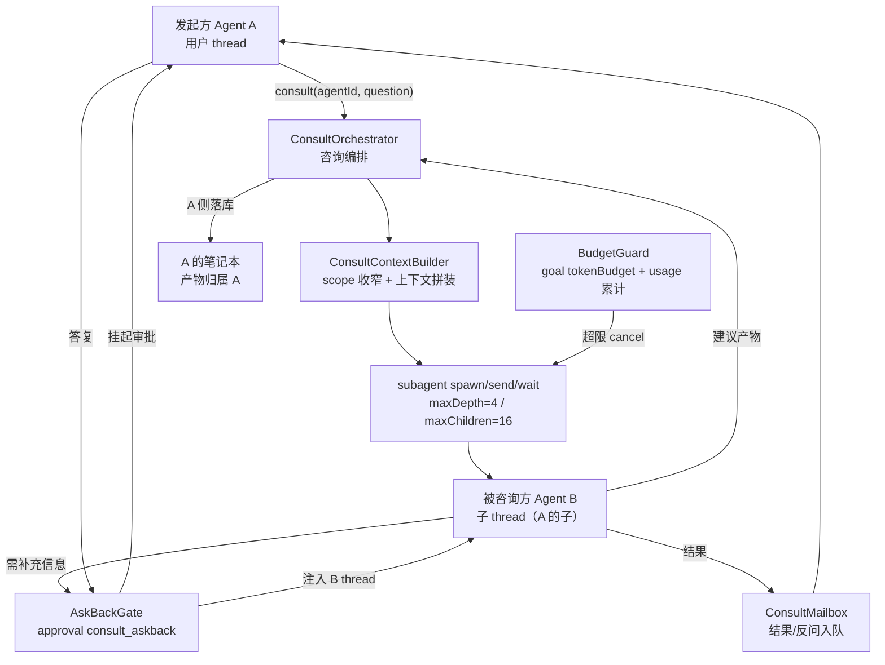

# F4 本机 Agent 协作设计（详细版）

> 状态：设计稿 v1.0（详细设计，待评审）｜ 2026-10-17
> 上游：[AGENT-NETWORK-PLAN.md](./AGENT-NETWORK-PLAN.md) F4 域、Saiye 决策 2（预算授权/递归防护/反问三硬需求）
> 前置：[AGENT-PROFILE-MODEL.md](./AGENT-PROFILE-MODEL.md)（agentId ↔ agentPresets）、[AGENT-SKILL-SYSTEM.md](./AGENT-SKILL-SYSTEM.md)（工具授权）、[REDACTION-PIPELINE.md](./REDACTION-PIPELINE.md)（本机不脱敏，scope 收窄）

## 1. 设计概述

### 1.1 目的与范围

本机 Agent 协作让用户的个人 Agent A 咨询同设备上的个人 Agent B，复用 B 的专长与知识，产物归 A。本设计覆盖：咨询编排、上下文构造、预算护栏、反问通道、异步信箱。

不覆盖：跨用户/跨设备咨询（路线 B）、计费（本机无 credits）、B 自主发起咨询（本期只支持 A 发起）。

### 1.2 需求追溯

| 编号 | 需求 | 来源 |
| --- | --- | --- |
| C1 | A 可按 B 的 agentId 发起咨询，问题与结果以结构化消息流转 | AGENT-NETWORK-PLAN F4 |
| C2 | 咨询有 token 预算上限，超限中断且不归零计费 | Saiye 决策 2 预算 |
| C3 | 咨询嵌套深度受限，不无限递归 | Saiye 决策 2 递归防护 |
| C4 | B 需补充信息时可向 A 反问，A 答复后继续 | Saiye 决策 2 反问 |
| C5 | B 可见内容受 A 的 disclosure_scope 约束（本机不脱敏但收窄） | REDACTION-PIPELINE 本机版 |
| C6 | 产物归属当前咨询者 A，B 不获得独立写权限 | Saiye P4 产物归属 |

### 1.3 已决策项

- D-C1：咨询 = 一次 subagent 运行（B 是 A 的子 thread，复用现有 depth=4 限制），不新建独立会话类型
- D-C2：预算 = goal tokenBudget，创建子 thread 前设定，运行中累计 usage 触发 `budgetLimited` 后取消子 thread
- D-C3：反问 = approval 新类别 `consult_askback`，B 通过工具调用触发，挂起 A 的审批 UI，答复注入 B 的 thread
- D-C4：本机咨询不脱敏（F6 只管出设备），但 B 的素材检索严格限定在 A 的 `disclosure_scope` 内
- D-C5：B 的工具授权 = `flowix.memo read`（scope 内），无 write；产物由 A 侧编排落回 A 的笔记本

## 2. 总体架构



两条结构性约束。第一，嵌套深度由 subagent 的 `maxDepth=4` 在 spawn 时硬校验（[subagent-service.js:634](file:///workspace/dsh-appserver/src/app-server/services/subagent-service.js#L634)），A→B 为 depth 1，B 再咨询 C 为 depth 2，到第 5 层 spawn 直接抛错——递归防护不依赖流程自觉。第二，预算在子 thread 创建前由 goal 设定，运行中 usage 累计达到上限即取消子 thread，预算耗尽的失败不进入下一轮重试。

## 3. 组件详细设计

### 3.1 ConsultOrchestrator

编排整个咨询生命周期。

**输入**：`{ fromAgentId, toAgentId, question, contextNoteIds?, tokenBudget? }`
**输出**：`ConsultHandle { consultId, status, mailbox }`

**主流程伪代码**：

```
async consult(req):
    target = resolve_agent_preset(req.toAgentId)   // agentPresets → runtime config
    if not target: return error AGENT_NOT_FOUND
    guard = BudgetGuard.create(parentThreadId=A.thread, budget=req.tokenBudget || default)
    scope = AgentAccessStore.enabled_entries(A.agentId) ∩ profile.disclosure_scope
    ctx = ConsultContextBuilder.build(scope, req.question, req.contextNoteIds, target.profile)
    child = await subagent.spawn(A.thread, {
        prompt: ctx.prompt,
        preset: target.presetKey,
        model: target.model,
        agentPath: [A.thread],
    })
    mailboxes[consultId] = new ConsultMailbox(child.childThreadId)
    guard.monitor(child.childThreadId)            // 异步累计 usage
    return ConsultHandle(consultId, child.childThreadId)

on child completed:
    result = subagent.wait(child.childThreadId)
    mailbox.push({kind: "result", answer: result.text, artifactSuggestion: result.toolCalls})
    budget = guard.finalize()
    mailbox.push({kind: "budget_used", tokens: budget.used})
on child cancelled (budget):
    mailbox.push({kind: "failed", reason: "budget_exceeded"})
```

**失败语义**：spawn 失败（depth 超限 / 并发超限）→ 同步返回错误，不创建 mailbox；运行中失败 → mailbox 推 `failed`，咨询终结。

### 3.2 ConsultContextBuilder

按 disclosure_scope 收窄 A 的可见面，拼装给 B 的咨询提示词。

```
build(scope, question, contextNoteIds, targetProfile):
    materials = note_index.list_memos_by_scope_updated_after(A.nb, scope, limit=30)
    // 若用户指定 contextNoteIds，优先使用并校验在 scope 内
    if contextNoteIds: materials = filter(contextNoteIds in scope)
    // 注入：B 自己的 profile（专长/记忆）+ A 的问题 + 收窄素材
    prompt = f"""
你是 Agent「{targetProfile.displayName}」，专长：{targetProfile.expertise}。
另一位 Agent 向你咨询：

<question>{question}</question>

<materials>
{materials fenced}
</materials>

请基于你的专长与以下素材作答。如需补充信息，调用 consult_askback 工具。
建议产物（如需要）以结构化建议返回，由咨询方决定是否落库。
"""
```

**边界**：不注入 A 的完整 profile（只给问题与素材），不注入 A 未授权的笔记；不执行 B 的写操作。

### 3.3 BudgetGuard

预算护栏，复用 goal 体系。

```
create(parentThreadId, budget):
    goal = goalService.create(parentThreadId, {
        objective: `consult to ${toAgentId}`,
        tokenBudget: budget,
        status: "active",
    })
    return guard{goalId, threadId, used:0, limit:budget}

monitor(childThreadId):
    // 订阅 flowix/session/usage 事件（子 thread 的用量通过 parent 聚合）
    on usage(threadId=childThreadId, tokens):
        guard.used += tokens
        if guard.used >= guard.limit:
            goalService.update(guard.goalId, {status: "budgetLimited"})
            subagent.cancel(childThreadId)   // 取消子 thread
finalize():
    return {used: guard.used, remaining: max(0, limit-used)}
```

**与 goal 状态映射**：`budgetLimited` 直接复用 goal 现有状态（[goal-service.js:11](file:///workspace/dsh-appserver/src/app-server/services/goal-service.js#L11)），不新造状态。预算耗尽时 goal 自身进入 budgetLimited，编排层据此取消子 thread。

### 3.4 AskBackGate

反问通道，复用 approval 机制。

**触发**：B 的 thread 内置一个 `consult_askback` 工具，B 调用时提交 `{question, options?}`。编排层拦截该工具调用 → `approvalManager.handle({kind: "consult_askback", threadId: A.thread, details: {from: B, question}})` → approval 发送给 A 的 UI 挂起（pending，120s 超时，断线重放）。

**答复回流**：A 在 UI 提交答复 → `approvalManager.resolve(A.connectionId, requestId, {approved: true, answer})` → 编排层把 `answer` 作为 `consult_askback` 工具的返回值注入 B 的 thread → B 继续推理。

```
on consult_askback(question):
    req = ApprovalRequest(kind="consult_askback", threadId=A.thread,
                          details={question, fromAgent: B.agentId})
    approvalManager.handle(req)   // 挂起，120s
    // resolve 回调：
    return approved ? answer : "咨询方未答复，请基于现有信息作答"
```

**超时语义**：120s 未答复，approval 自动 resolve 为未答复，B 收到兜底提示继续，不无限挂起。

### 3.5 ConsultMailbox

异步信箱，咨询结果/反问/预算事件入队，A 的 thread 可轮询或事件订阅。

```rust
struct ConsultMailbox {
    consult_id: String,
    child_thread_id: String,
    events: VecDeque<ConsultEvent>,   // result / failed / askback / budget_used
    listeners: Vec<tokio::sync::Notify>,
}
```

事件以 `consult-event` Tauri 事件推送前端；断线重连后 A 可通过 `consult_status` 拉取积压事件（mailbox 保留最近 100 条，TTL 24h）。

## 4. 接口契约

### 4.1 Rust 结构

```rust
pub struct ConsultRequest {
    pub from_agent_id: String,
    pub to_agent_id: String,
    pub question: String,
    pub context_note_ids: Vec<String>,
    pub token_budget: Option<u64>,
}

pub struct ConsultHandle {
    pub consult_id: String,
    pub child_thread_id: String,
    pub status: ConsultStatus,   // pending | running | completed | failed | budget_exceeded
}

pub enum ConsultEvent {
    Result { answer: String, artifact_suggestion: Option<String> },
    Failed { reason: String },
    Askback { question: String, options: Vec<String> },
    BudgetUsed { tokens: u64, remaining: u64 },
}
```

### 4.2 IPC 命令

| 命令 | 参数 | 返回 | 错误码 |
| --- | --- | --- | --- |
| `consult_initiate` | ConsultRequest | ConsultHandle | `AGENT_NOT_FOUND` `DEPTH_EXCEEDED` `CONCURRENCY_EXCEEDED` `BUDGET_INVALID` |
| `consult_status` | consultId | ConsultHandle + 待处理事件数 | `CONSULT_NOT_FOUND` |
| `consult_events` | consultId, afterSeq | ConsultEvent[]（最近 100 条） | `CONSULT_NOT_FOUND` |
| `consult_askback_reply` | consultId, requestId, answer | 注入 B thread 结果 | `CONSULT_NOT_FOUND` `ASKBACK_EXPIRED` |
| `consult_cancel` | consultId | 取消子 thread | `CONSULT_NOT_FOUND` |

### 4.3 错误码含义

- `DEPTH_EXCEEDED`：subagent `maxDepth=4` 已用满（A→B→C→D→E 共 5 层被拒）
- `CONCURRENCY_EXCEEDED`：A 已有 16 个并发子 thread
- `ASKBACK_EXPIRED`：反问超过 120s 未答复

## 5. 数据面

| 路径 | 内容 | 层级 | 生命周期 |
| --- | --- | --- | --- |
| `<nb>/.flowix/agents/<fromId>/consults/<consultId>.json` | 咨询元数据：toAgentId、status、createdAt、tokensUsed、childThreadId | 本地 | TTL 7 天，超期清理 |
| `<nb>/.flowix/agents/<fromId>/consults/<consultId>.events.jsonl` | 事件日志（result/failed/askback/budget） | 本地 | 随元数据清理 |
| `~/.flowix/consult.json` | 全局默认：默认 tokenBudget、并发上限覆盖 | 设备级 | 用户可改 |

设计理由：咨询状态是设备运行态（线程生命周期），不进同步；事件日志用于断线重连与可解释性。

## 6. 非功能设计

**递归防护（C3）**：subagent `maxDepth=4` 在 spawn 入口硬校验，编排层不重复实现；并发 `maxChildren=16` 同理。

**成本（C2）**：goal tokenBudget 是硬上限，usage 累计通过既有 `flowix/session/usage` 事件聚合。

**隐私（C5）**：B 的素材严格限定 A 的 disclosure_scope；本机不脱敏（内容不离开设备）。B 无 write 工具，产物由 A 侧决定落库。

**并发**：同一 toAgentId 可被多个 fromAgent 同时咨询（各自独立子 thread）；同一 fromAgent 的并发受 maxChildren 限制。

**断线恢复**：子 thread 是 durable thread（现有 cold-resume），编排层重启后通过 `subagent.list(parent)` 重连未完成的咨询；mailbox 事件通过 consult_status 重放。

## 7. 集成影响

| 触点 | 变更 | 性质 |
| --- | --- | --- |
| `subagent-service.js` | 不改（复用 spawn/send/wait/cancel） | 无 |
| `goal-service.js` | 不改（复用 create/update tokenBudget） | 无 |
| `approval-manager.js` + 前端审批 UI | 新增 `consult_askback` 类别呈现 | 增量 |
| `app/flowix-desktop/src/consult/`（新模块） | orchestrator/context/budget/askback/mailbox | 全新增量 |
| DSH runtime | B 的 thread 注入 `consult_askback` 工具 + `flowix.memo read`（scope 内） | 增量 |

## 8. 实施步骤

1. **C-M1**：ConsultOrchestrator + ConsultContextBuilder + subagent 调用 + mailbox。验收：A 发起咨询 → B 子 thread 运行 → 结果回流；depth 超限返回 DEPTH_EXCEEDED。
2. **C-M2**：BudgetGuard（goal tokenBudget + usage 累计 + cancel）。验收：预算内正常完成；超限子 thread 被取消，mailbox 推 budget_exceeded，usage 正确。
3. **C-M3**：AskBackGate（approval consult_askback 类别 + 工具注入 + 答复回流）。验收：B 调用 askback → A UI 挂起 → 答复注入 B；120s 超时兜底。
4. **C-M4**：断线恢复 + 事件重放 + 前端咨询状态区。验收：编排层重启后未完成咨询可重连；consult_events 重放不丢。

## 9. 测试用例

| # | 输入 | 预期 |
| --- | --- | --- |
| T1 | A 咨询 B，B 正常答复 | mailbox 收到 result，consult 状态 completed |
| T2 | A 已有 16 个并发咨询，发起第 17 个 | CONCURRENCY_EXCEEDED |
| T3 | A→B→C→D→E 嵌套 5 层 | E 的 spawn 返回 DEPTH_EXCEEDED |
| T4 | tokenBudget=1000，运行消耗超 1000 | 子 thread 取消，mailbox budget_exceeded |
| T5 | B 调用 consult_askback | A UI 挂起审批，120s 不答复自动兜底 |
| T6 | A 答复 askback | 答复注入 B thread，B 继续并出结果 |
| T7 | contextNoteIds 含 scope 外笔记 | 被剔除，仅注入 scope 内 |
| T8 | B 尝试调用 write 工具 | 被拒绝（B 只有 read） |
| T9 | 编排层重启，咨询未完成 | 重连子 thread，状态恢复 |
| T10 | consult_events 断线重连拉取 | 积压事件完整返回，无重复 |
| T11 | B 建议产物 | 由 A 侧落库到 A 的笔记本，B 无独立写 |
| T12 | 默认 tokenBudget（未指定） | 使用全局配置，不无限 |

## 10. 未决事项

1. `consult_askback` 工具在 B thread 的注入方式：通过 DSH skill 注入还是 runtime 内置工具——倾向 runtime 内置（确定性更强）`[To be confirmed]`
2. B 看到的 A 的身份信息：只给 displayName 还是也给 A 的 expertise（帮助 B 理解提问背景）——倾向只给 displayName + 问题，避免 A 的画像外泄给 B 的推理上下文 `[Hypothesis]`
3. 产物建议的落库确认：B 返回 artifactSuggestion 后，A 是自动落库还是经用户确认——倾向经用户确认（避免 B 误写污染 A 笔记）`[To be confirmed]`
4. 咨询历史的可回溯性：是否在 A 的 memories.md 记录「曾咨询 B 得到 X」——倾向由喂养管道在 A 的下次喂养时决定是否沉淀，咨询本身不直接写记忆 `[Hypothesis]`
