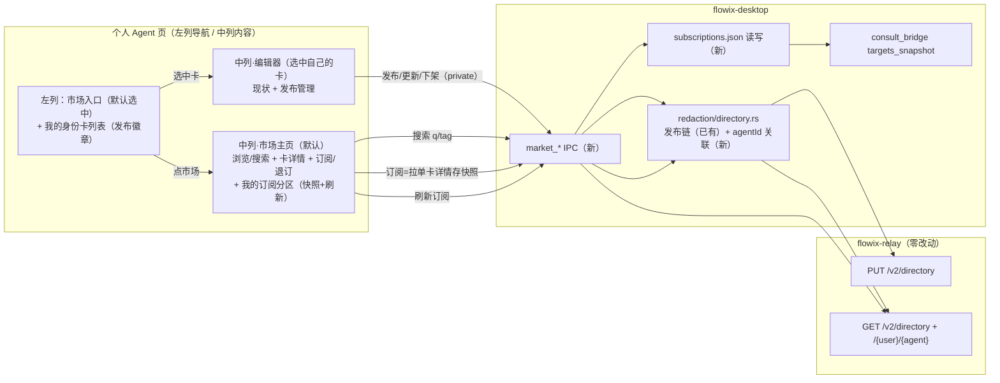

# Agent 身份卡市场（发布 / 浏览 / 搜索 / 订阅）设计

> 状态：设计稿 v1.0（待评审）｜ 2026-10-29
> 依据：F5-CROSS-USER-NETWORK §4/§7（目录发现、中继 API v2，M2-M5 已交付）、AGENT-PROFILE-REDESIGN（身份卡模型）、FD-12 M2（consult_targets）

## 0. 需求追踪表

| # | 需求 | 来源 | 证据 |
| --- | --- | --- | --- |
| R1 | 身份卡页罗列自己的 agent 身份卡，并选择是否发布（发布/下架/更新） | 用户 2026-10-29 | `[Data-backed]` 本地 profile 列表已有（`AgentProfileListPanel`），发布链已有（F5 M3 ✅），两者未关联 |
| R2 | 在此页浏览、搜索、订阅其他用户已发布的 agent | 用户 2026-10-29 | `[Data-backed]` relay 目录搜索端点与收件箱内嵌搜索 UI 已有（F5 M3 ✅）；「订阅」为全新概念 `[Hypothesis]` 语义见 D-5 |

本设计关闭的关键决策：

| # | 决策 |
| --- | --- |
| D-1 | 市场落位（用户定稿 2026-10-29）：「个人 Agent」页**左列 = 我的身份卡列表（含发布徽章），中列默认 = 市场主页**。左列顶部固定「市场」入口项（默认选中）；点自己的卡 → 中列切编辑器，点市场项 → 回市场。「我的订阅」一期为市场页内分区，不进左列（避免可编辑卡与只读订阅卡混淆；二期可提升为左列分组，见 O6）；未登录 relay 时市场页显示账号引导；收件箱面板里的旧搜索框保留不迁移 |
| D-2 | 发布与身份卡强关联：`DirectoryCardDraft` 增加 `agentId` 字段（serde default 兼容旧档）；发布入口移到我的卡列表，slug/displayName/专长**从 profile 派生预填**（保留可改） |
| D-3 | 下架 = 复用发布链重发 `visibility=private` 卡（relay 无 DELETE 端点；private 档投递即 `RECIPIENT_UNKNOWN`，等价下架）——**relay 零改动** |
| D-4 | 「我的发布状态」= 扫描 `<nb>/.flowix/redaction-directory/` 中 confirmed/published 档按 `agentId` 关联回 profile 列表；profile 与已发布内容漂移时列表提示「内容已变化，可重新发布」 |
| D-5 | 订阅（一期）= **本地关注列表**：订阅时拉单卡详情存快照（address/displayName/tags/R 级/autoAnswer/relayUrl/订阅时间）落 `~/.flowix/redaction/subscriptions.json`（全局，与 account.json 同层）；动作仅订阅/退订/手动刷新；**无服务端推送**，无自动轮询 |
| D-6 | 订阅卡并入 `consult_targets` 枚举（targets_snapshot 数据源增加 subscriptions，地址为完整 `user/slug@relay`），使对话内咨询可直接点名已订阅 agent |
| D-7 | 发布内容边界维持 F5 §4 白名单（displayName/专长标签/R 级/autoAnswer/公钥），**不**新增 bio/system/memory 出站面——memory 是披露授权（入站语义），与公开卡无关 |
| D-8 | relay 云端零改动：发布/搜索/详情/下架全部复用现有 `PUT/GET /v2/directory` 端点与限流（目录写 10 次/天） |

## 1. 现状盘点（代码事实）

| 已有设施 | 位置 | 与需求的差距 |
| --- | --- | --- |
| relay 目录 API：`PUT /v2/directory/{user}/{agent}`（`routes.rs:607`，写限流 10/天 `routes.rs:34,665`）、`GET /v2/directory?q=&tag=`（`:715`，支持 limit/offset）、`GET /v2/directory/{user}/{agent}`（`:732`）；private 档投递拒绝（`:152`） | `app/flowix-relay/src/routes.rs` | 无 DELETE；下架走 private（D-3） |
| 发布链状态机 draft→confirmed/cancelled→published，L1 脱敏 + 确认门，留档 `<nb>/.flowix/redaction-directory/<id>.json` | `app/flowix-desktop/src/redaction/directory.rs`（`DirectoryCardDraft:25`、`publish_preview:109`、`settle_draft:200`） | draft 无 agentId 关联；无「我的发布清单」聚合；无下架动作 |
| IPC：`redaction_directory_preview/confirm/publish/search/card` | `commands/redaction.rs:506-566`；前端 `client/redaction.ts:117-140` | 缺 market_my_cards / 订阅 CRUD |
| 发布/搜索 UI（`PublishCardDialog` 手填 slug+名称+标签；`DirectorySearchBox` 搜索+复制地址） | `features/agent/components/relay-account-section.tsx:206,281`，挂**收件箱面板** relay 账号区 | 不在身份卡页；发布与 profile 无关；搜索结果无详情、无订阅动作 |
| consult_targets 枚举源 = redaction 配置 `registered_agents` + 账号补全命名空间地址 | `redaction/consult_bridge.rs:310 targets_snapshot` | 未含外部 agent；订阅卡应并入（D-6） |
| 全局单账号 `~/.flowix/redaction/account.json`（Ed25519，绑单中继） | `redaction/account.rs:97` | 订阅列表同层落点（D-5） |
| 身份卡模型（flowix_ 前缀 + memory 即披露授权） | `flowix-core/src/agent/mod.rs` | 无发布/relay 字段；**不加**（发布态属设备/账号级，放 draft 档） |

完成度评估：后端与 relay 侧约 **80% 可复用**（目录 API、发布链、限流、账号签名全现成）；缺口集中在**前端信息架构**（市场视图）、**发布-身份卡关联**与**订阅**这一薄层。

## 2. 架构



结构性质：出设备内容**只有一个出口**——发布/更新/下架全部经既有 directory.rs 的 L1 过闸 + 确认门状态机（下架重发 private 也过同一闸，不新增旁路）；订阅是**纯入站读操作**（GET 单卡 + 本地快照），不产生任何出站写。

## 3. 组件设计

### 3.1 左列导航与我的卡发布管理（`agent-profile-cards.tsx`）

- 职责：左列顶部固定「市场」入口项（默认选中，中列显示市场主页）；「我的身份卡」分组列表每卡显示发布状态徽章与发布动作；点卡 → 中列编辑器（现状）。
- 输入：`market_my_cards(cwd)` 返回的聚合列表；输出：发布/更新/下架触发、市场/卡片选中态。
- 复用：`PublishCardDialog` 整体迁移至编辑器视图并改为**从 profile 预填**（displayName = `flowix_display_name`、标签 = `flowix_expertise`，仍可编辑；已发布卡预填 slug 与 visibility 保持）。
- 边界：不做 profile→卡自动同步（列表提示漂移，用户手动重发）；「市场」选中态在会话内保持（含刷新后恢复，落前端视图 store）。
- 失败语义：relay 不可达时动作为本地错误提示，draft 状态不受影响。

### 3.2 市场主页（新 `agent-market.tsx`，挂中列）

- 职责：浏览（空查询 = 全量第一页）、关键词/标签搜索、卡详情、订阅/退订、我的订阅分区（快照列表 + 手动刷新）；未登录 relay 时显示账号引导（复用收件箱账号区逻辑与组件）。
- 输入：搜索框 + `market_search`；输出：卡列表（displayName/地址/R 级/autoAnswer 位）+ 详情展开（完整卡 JSON 白名单字段）。
- 边界：一期不做分页加载（limit 固定 50）、不做排序/评分；举报入口复用 `redaction_report_abuse`（详情区按钮）。
- 失败语义：搜索失败显示错误行（限流 429 文案透传 relay 返回）。

### 3.3 订阅存储（`redaction/subscriptions.rs` 新模块）

```text
subscribe(card)      // 落快照；address 已存在 = 幂等覆盖更新
unsubscribe(address) // 删除
list() -> Vec<SubscribedCard>
refresh(address)     // GET /v2/directory/{user}/{agent} → 覆盖快照；
                     // 卡已 private/不存在 → 返回 NOT_FOUND，由 UI 提示可退订
```

- 边界：不校验签名（卡是公开自述面，公钥仅 consult 时做信任锚）；不做 TTL/自动清理。
- 落盘：原子写（tmp+rename，同 account.json 惯例）。

### 3.4 consult_targets 并入（`consult_bridge.rs:310`）

targets 数组在现有 registered_agents 之后追加 subscriptions 源：`agentId = user/slug`，`address = user/slug@relayUrl`（快照自带，不依赖本地账号）。短地址补全 `resolve_target` 不变。

## 4. 接口契约

### IPC 新增（desktop，全部薄封装）

| 命令 | 参数 | 返回 | 错误码 |
| --- | --- | --- | --- |
| `market_my_cards` | `cwd` | `Vec<MarketMyCard>` | `NOTEBOOK_INVALID` |
| `market_search` | `q?, tag?, relayUrl?` | `Vec<DirectoryCard>` | relay 透传（`RATE_LIMITED` 等） |
| `market_subscribe` | `card: DirectoryCard` | `SubscribedCard` | `SUBSCRIBE_FAILED` |
| `market_unsubscribe` | `address` | `()` | `NOT_SUBSCRIBED` |
| `market_subscriptions` | — | `Vec<SubscribedCard>` | — |
| `market_refresh_subscription` | `address` | `SubscribedCard` | `NOT_FOUND` / `RELAY_UNREACHABLE` |

```json
// MarketMyCard（聚合：profile + 发布态）
{
  "agentId": "agt_a83d9cf0f4a530af",
  "displayName": "财报解读助手",
  "expertise": ["finance/财报"],
  "publishState": "published",          // none | draft | confirmed | published
  "publishedSlug": "caibao",            // published/confirmed 时有
  "visibility": "unlisted",             // published 时有
  "drifted": true                       // profile 的名称/专长 ≠ 发布快照
}
// SubscribedCard（订阅快照）
{
  "address": "alice/caibao",
  "relayUrl": "http://8.160.162.251:8788",
  "displayName": "财报解读助手",
  "specialtyTags": ["finance/财报"],
  "minRedactionLevel": "R2",
  "autoAnswer": "off",
  "cardPublicKey": "…",
  "subscribedAt": 1793200000,
  "refreshedAt": 1793200000
}
```

字段约束：`address` 形如 `user/slug`（不含 @relay，relay 独立字段承载）；`drifted` 仅比较 `displayName` 与 `expertise` 集合（发布白名单内的可比项）。

### relay 契约（复用，零新增）

`PUT /v2/directory/{user}/{agent}` body 的 `visibility` 三档即发布/隐藏/下架语义；`GET /v2/directory?q=&tag=&limit=&offset=`；`GET /v2/directory/{user}/{agent}`。

## 5. 数据面

| 路径 | 内容 | 同步/本地 | 生命周期 |
| --- | --- | --- | --- |
| `<nb>/.flowix/redaction-directory/<draftId>.json`（已有） | 发布状态机档，**新增 `agentId` 字段**（`#[serde(default)]` 兼容旧档） | 本地（.flowix 不随云同步） | 下架后保留档（visibility=private 的终态留痕） |
| `~/.flowix/redaction/subscriptions.json`（新） | 订阅快照数组 | 本地全局（跨笔记本可 consult） | 退订即删条目 |
| profile.md（不动） | 身份卡本体 | 随云同步 | 不承载发布态（设备/账号级语义不入同步面） |
| relay SQLite directory 表（不动） | 公开卡 | 云端 | 由 PUT 覆盖更新 |

## 6. 非功能与侵入度

- 安全：出站仅发布链既有闸（L1 + 确认门 + 目录写限流 10/天）；订阅只读；卡详情展示不渲染富文本（纯字段），无注入面。
- 隐私：公开卡字段白名单不扩（D-7）；搜索请求按 deviceToken 限流（120 拉取/小时共享）。
- 并发：subscriptions.json 单文件原子写；多窗口并发写以最后写胜（与 account.json 同风险级别，可接受）。

| 变更点 | 侵入度 |
| --- | --- |
| `redaction/directory.rs`（+agentId 字段、my_cards 聚合、下架重发） | 中（改现有结构体，serde default 保兼容） |
| `redaction/subscriptions.rs`（新） | 纯新增 |
| `commands/market.rs`（新 IPC 模块） | 纯新增 |
| `consult_bridge.rs targets_snapshot`（+订阅源） | 小（追加数据源） |
| `agent-profile-cards.tsx`（视图切换 + 发布徽章 + 迁入 PublishCardDialog） | 中 |
| `agent-market.tsx`（新） | 纯新增 |
| `client/market.ts` + i18n ×2 | 纯新增 |
| flowix-relay / flowix-core | **零改动** |

## 7. 执行里程碑

| # | 内容 | 验收 |
| --- | --- | --- |
| M1 | 发布-身份卡关联 + 我的发布管理：draft +agentId、`market_my_cards`、卡列表发布徽章/漂移提示、PublishCardDialog 迁入并 profile 预填、下架（private 重发） | ✅ 2026-10-29：directory 单测 +3（聚合三态/旧档兼容/下架克隆）；desktop lib 804/804；前端 cards 8/8（含徽章+下架入口用例）+ tsc；云端 cross_user_m5 复跑通过（发布/目录/投递链零回归）。实现中发现并修复：聚合选择器需以 created_at 最新为准（下架 private 档才能覆盖旧 published 档的视图） |
| M2 | 市场视图：视图切换、浏览/搜索（q+tag）、卡详情展开 | ✅ 2026-10-29：左列「市场」入口默认选中（target null / market → 中列市场主页）；空查询自动浏览第一页；q+tag 搜索 + 卡详情展开（完整地址/可见性/R 级/autoAnswer/更新时间）+ 复制地址；未登录显示账号引导（复用 RelayAccountSection）；错误文案透传。market 5 测 + cards 8 测 + tsc 通过；agent 组件区仅剩既有失败（agent-tasks-recent，与本次无关）。实现中修复：默认浏览 effect 依赖 search 引用（随 busy 变化）会在失败时无限重试 → 一次性 ref 标记 |
| M3 | 订阅 + consult 联动：subscriptions 存储、订阅/退订/刷新、订阅区列表、targets_snapshot 并入 | ✅ 2026-10-29：subscriptions.rs（幂等 upsert/退订 NOT_SUBSCRIBED/地址校验/快照映射 4 测，thread_local 路径注入）；4 IPC；targets_snapshot 并入（bridge 5 测含 D-6 完整地址断言）；市场页订阅按钮 + 我的订阅分区（market 7 测）；desktop 808/808 + tsc + 云端 cross_user_m5 通过。实现修正：契约中 `market_subscribe(card)` 落地为 `market_subscribe(address, relayUrl?)`（订阅内部 GET 单卡详情存快照，与 D-5 一致，无需前端传整卡）。教训记录：Windows `dirs::home_dir` 不读 env，早期 env 注入方案曾污染真实 HOME 的 subscriptions.json（已即时发现清理，改 thread_local 注入） |

## 8. 测试锚点

| # | 输入 → 预期 |
| --- | --- |
| T1 | `market_my_cards`：无 draft 的 profile → `publishState: none` |
| T2 | 旧格式 draft（无 agentId）读入 → 反序列化成功，关联为空不崩溃 |
| T3 | 发布全链（预填→preview→confirm→publish）→ relay PUT 200，`market_my_cards` 返回 published + slug |
| T4 | 下架：对 published 卡重发 private → relay `GET /v2/directory` 搜不到；投递该地址 → `RECIPIENT_UNKNOWN` |
| T5 | 漂移：published 后改 profile displayName → `drifted: true`；仅改 memory/system → `drifted: false`（白名单外不比对） |
| T6 | 搜索空查询 → relay 返回第一页（≤50）；q 命中 displayName/tag |
| T7 | 订阅 → subscriptions.json 落快照；重复订阅同地址 = 幂等覆盖 |
| T8 | 退订 → 列表移除，`market_unsubscribe` 再调 → `NOT_SUBSCRIBED` |
| T9 | 刷新 private 卡 → `NOT_FOUND`；relay 断连 → `RELAY_UNREACHABLE`，快照不动 |
| T10 | 订阅后 `consult_targets`（bridge GET /targets）→ targets 含 `user/slug@relayUrl` 完整地址；无账号时短地址补全不误伤完整地址 |
| T11 | 目录写限流：>10 次/天 PUT → relay 429，UI 错误透传，draft 留 confirmed 可重试 |
| T12 | 兼容：不订阅不发布时 consult_targets 输出与改动前 byte-equal（回归） |

## 9. 开放项

| # | 事项 | 状态 |
| --- | --- | --- |
| O1 | 订阅更新推送（SSE / 轮询 / 卡变更通知） | `[To be confirmed]` 一期不做，依赖 F5 P2 get_events 演进 |
| O2 | 搜索分页/排序/按订阅数热度 | `[To be confirmed]` relay 已支持 limit/offset，UI 一期固定第一页 |
| O3 | 跨中继多账号订阅的账号切换体验（现状全局单账号绑单中继；订阅快照自带 relayUrl，consult 不受影响，仅「发布侧」单中继） | `[Hypothesis]` 可接受，随 F5 多中继演进的再审 |
| O4 | 市场卡的内容审核举报闭环（入口已留，处理端待 relay 运营侧） | `[To be confirmed]` |
| O5 | published 卡与 profile 的自动同步（重发提示已有，一键重发为候选增强） | `[To be confirmed]` |
| O6 | 「我的订阅」从市场页内分区提升为左列「已订阅」分组（高频管理场景出现后再做；需解决可编辑卡/只读订阅卡的视觉区分） | `[To be confirmed]` |
