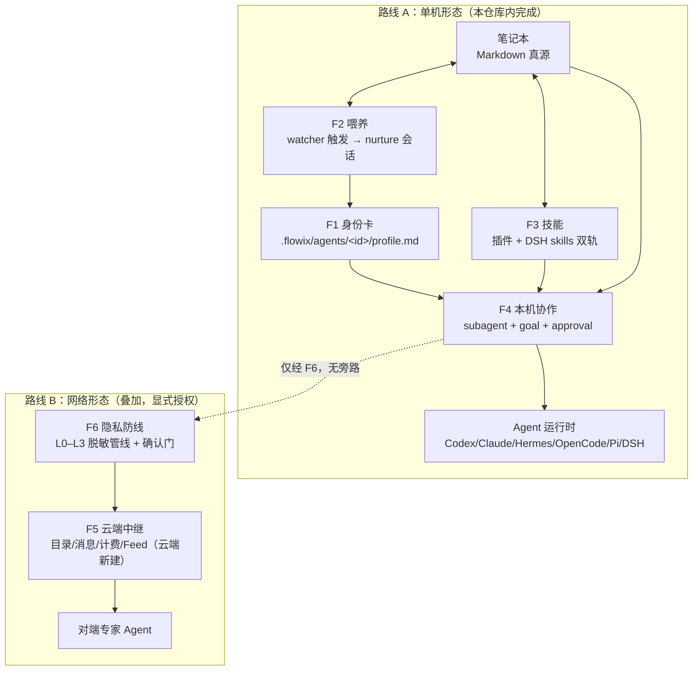
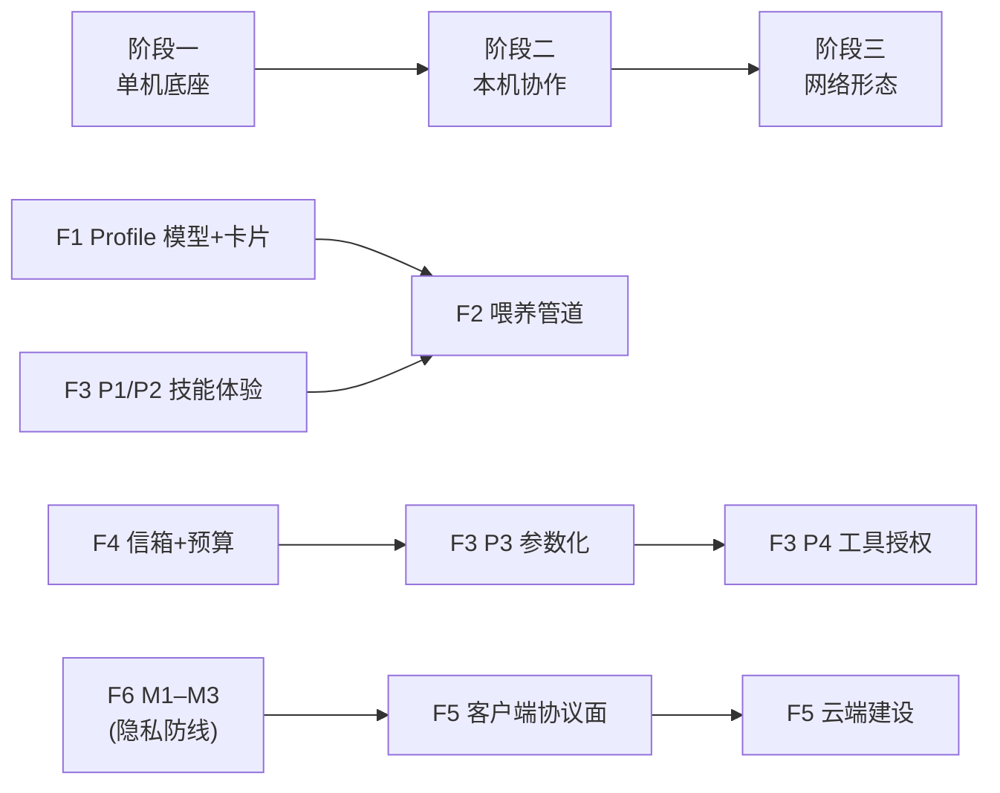

# Flowix Agent 网络规划与评估方案

> 状态：v1.0 ｜ 2026-10-16 ｜ 基线：main（Flowix 1.5.6）
> 需求源：《Saiye Agent 网络愿景：需求拆解与完成度评估》（D0–D6）、《专家技能体系 P1–P4 实施方案》
> 关联设计：[REDACTION-PIPELINE.md](./REDACTION-PIPELINE.md)（隐私防线详细设计）、[docs/wiki/](./wiki/README.md)（代码库全量分析）

## 1. 愿景与产品闭环

Flowix 的 Agent 网络愿景与 Saiye 同源：个人内容喂养出独特 Agent，Agent 之间可以互相咨询，反馈持续优化。落地架构不同——Saiye 是云端多用户平台（PG/Redis/平台推理），Flowix 是本地优先桌面应用（Markdown 真源 + 用户自带 Agent CLI + 可选云端中继）。这份差异决定了整个规划：**先把单机形态做成立得住的产品，网络形态作为显式授权的可选叠加**。

产品闭环（Flowix 语境）：

```
笔记（Markdown 真源） → 喂养（本地蒸馏画像/记忆） → 个人 Agent（身份卡）
   → 本机协作（我的专家互咨） → [可选] 入网互咨（脱敏出设备）
   → 反馈优化（产物回写笔记、留档审计）
```

两种产品形态与关系：

| 形态 | 内容 | 产品可独立性 |
| --- | --- | --- |
| 单机形态（路线 A） | 身份卡、喂养、专家技能、本机 Agent 协作 | 独立成立，零网络依赖，与本仓库现有架构同构 |
| 网络形态（路线 B） | 目录发现、跨用户互咨、计费、Feed | 叠加层；每次出设备经脱敏管线与确认门 |

## 2. 需求域重组

Saiye 的 D0–D6 按云平台建设域划分。按 Flowix 的架构前提重组为七个域：网络能力收敛到 F5 一个域，隐私从 Saiye 的子项（D2-c）升格为独立域 F6——这是两条路线的分界线，也是本规划与原愿景最大的结构差异。

| Flowix 域 | 目标 | 来源映射 |
| --- | --- | --- |
| F0 本地底座 | 单用户并发与存储安全 | D0（结论：本地形态下无需 PG/Redis） |
| F1 个人 Agent 身份 | Profile 即笔记 + 身份卡 | D1 |
| F2 知识喂养 | 原文蒸馏为画像/记忆/专长标签 | D2 |
| F3 专家技能 | 预制能力单元，点选执行，产物落笔记 | P1–P4 |
| F4 本机协作 | 我的多个 Agent 互咨与预算护栏 | D4 的本地子集 |
| F5 网络互咨 | 目录、跨用户消息、计费、Feed、云推送 | D3 + D4 网络部分 + D5 云端 + D6 |
| F6 隐私防线 | 出设备内容的脱敏管线与披露控制 | 本规划新增（消化 D2-c 并扩展） |

## 3. 完成度评估

完成度为工程判断，依据是 docs/wiki/ 的代码库全量分析与本会话核实；证据列给出可复查的代码位置。

### F0 本地底座 —— 100%（单机形态无需建设）

Saiye 需要 PG/队列/Redis 的根因是多用户多实例云部署。Flowix 单用户场景下，等价能力已存在：跨进程三层文件锁覆盖桌面/CLI/MCP/外部编辑器四方并发（`app/flowix-core/src/memo_file/operation_locks.rs`，集成测试 `app/flowix-cli/tests/locking.rs`）；SQLite WAL 承载投影；DSH RequestScheduler 提供进程内任务串行。云端方向只有账号/会员/结账的客户端契约（`app/flowix-sync/src/client.rs`），队列与实时基建不在本仓库，约 25%。

### F1 个人 Agent 身份 —— 约 40%

| 已落地 | 证据 |
| --- | --- |
| 笔记可承载任意元数据（frontmatter + 标签 + 7 色 + 图标） | `app/flowix-core/src/memo_file/frontmatter.rs`、`types.rs` |
| Agent 类型目录与能力描述（8 种，前端静态） | `app/flowix-web/lib/agent-types.ts` |
| DSH 侧人格/权限预设挂载点 | `dsh-appserver/src/app-server/runtime/native-dsh-runtime.js`（agentPresets/permissionPresets） |

缺口：Profile 数据模型（`.flowix/agents/<id>/profile.md` 约定）、卡片 UI、专长标签的自动生成（依赖 F2）、网络公开卡（依赖 F5）。

### F2 知识喂养 —— 约 35%

| 已落地 | 证据 |
| --- | --- |
| 事件源：文件监听 + memo-event 总线（区分 7 种变更来源） | `app/flowix-desktop/src/watcher/`、`memo_events.rs` |
| Agent 读写笔记回路（search/show/create/edit/write + 标签过滤检索） | `app/flowix-cli/src/mcp.rs`（memo 工具） |
| 访问控制（Notebook/Folder 粒度白名单） | `app/flowix-desktop/src/config/access.rs` |
| 本地版本历史（可承载记忆沉淀的留痕模式） | `app/flowix-core/src/memo_file/versions.rs` |

缺口：喂养编排（触发阈值 → nurture 会话 → 写回 profile/memories）、标签级 scope、蒸馏成本展示。喂养数据形态已定：**原文 + Markdown 蒸馏产物，无向量库**（2026-10-16 决策）；语义检索如需增强，后接 embedding 仅作检索层选件，不进入喂养回路。

### F3 专家技能 —— 综合约 50%（P1 70% / P2 55% / P3 30% / P4 45%）

Flowix 有两个现成技能载体，双轨并行：

| 载体 | 现状 | 对应 Saiye 阶段 |
| --- | --- | --- |
| 声明式插件（plugin.json + SKILL.md） | 已闭环：prepare_prompt 拼装 → Agent 执行 → parse 清洗 → 产物写回笔记本（`app/flowix-desktop/src/plugin.rs`） | P1 主体；P2 的导入导出（插件即目录+integrity）与统计（plugin-run 事件）近免费 |
| DSH skills（user/repo/system 三 scope） | 目录/启停/extraRoots 已有（`dsh-appserver/src/app-server/services/skill-catalog-service.js`） | 运行时消费面 |

P3（paramsSchema 参数化）契合 `flowix-plugin-runtime` 的 manifest 校验框架；P4（工具授权）的安全机制已就位：permissions 白名单（`agent.invoke/notebook.read/artifact.write`）+ DSH approval 确认门 + permission_mode 三档，且「产物归属咨询者」在 Flowix 天然成立（产物永远写进当前用户笔记本）。

### F4 本机协作 —— 约 50%

DSH 已具备：subagents（spawn/send/resume/wait，16 并发 4 深度，`subagent-service.js`）、goal 乐观版本、approval 四类审批、token 用量计量（`flowix/session/usage`）。缺口：跨 thread 异步信箱、token 预算上限与熔断、协作结果的笔记回写约定。

### F5 网络互咨 —— 约 10%

本仓库仅有的网络面是 dsh-appserver HTTP 传输（可恢复 SSE + 移动配对，`dsh-appserver/src/app-server/transports/http.js`），可复用为客户端协议面。目录/语义召回/跨用户消息/计费/Feed 均为真空，且全部属于云端新建，不在本仓库边界内。

### F6 隐私防线 —— 设计完成（v0.1 待评审），实现未启动

详细设计见 [REDACTION-PIPELINE.md](./REDACTION-PIPELINE.md)：四层管线（L0 白名单 → L1 规则引擎 → L2 蒸馏 → L3 后校验+人审）、R1–R3 脱敏分级、披露标记（maxHops/expiresAt）、出站留档。核心决策「不加密、仅脱敏」已定（2026-10-16）。

### 总体判断

| 路线 | 完成度 | 判断 |
| --- | --- | --- |
| 路线 A（单机形态） | **约 50%** | 推荐：全部缺口在本仓库内可补齐，架构同构无违和 |
| 路线 B（网络形态） | **约 10%** | 前置条件是 F6 实现落地 + 云端立项；本仓库承担客户端角色 |

## 4. 目标架构拓扑



拓扑的两条硬约束：路线 B 的所有出设备流量必须穿过 F6，出设备出口在确认门之后唯一存在（REDACTION-PIPELINE §2）；F1/F2/F3/F4 全部以笔记为数据面，不引入第二套业务状态存储，与「DSH Session event log 是唯一事实源」的现有设计纪律一致。

## 5. 决策记录

已定决策（本会话，编号续接 Saiye 决策表）：

| # | 决策 | 理由摘要 |
| --- | --- | --- |
| FD-1 | 运行时模型：默认外接（用户自带 CLI/key），不做平台 hosted 推理 | 与本地优先哲学一致；hosted 与「数据不出设备」冲突；外接模型使两端都是本地运行时 |
| FD-2 | 网络互咨不加密，仅脱敏 | LLM 无法在密文上推理；放弃 E2EE 换平台可读（计费仲裁/滥用检测/内容合规）；实现面收缩约三分之一 |
| FD-3 | 喂养数据形态：原文 + Markdown 蒸馏产物，无向量库 | 零外部依赖、人可读可改、可 Git；语义理解由 Agent 读原文承担 |
| FD-4 | 技能双轨制：声明式插件为单一真源，DSH skills 为运行时消费面 | 防止两套技能概念分裂 |
| FD-5 | Profile 即笔记（frontmatter schema） | 可同步（v2 同步键即路径）、可 Git、零新存储 |
| FD-6 | 出站留档不进笔记本、不参与云同步 | 留档属设备级审计数据，进笔记本会被同步带出设备 |

待定决策（不阻塞阶段一开工）：

| # | 事项 | 归属 |
| --- | --- | --- |
| FD-7 | approval 新增 disclosure 类别还是复用 permissions 类别 | REDACTION-PIPELINE M3 前定 |
| FD-8 | 蒸馏默认 Agent 类型/模型 | M2 前定（建议跟随用户默认 Agent） |
| FD-9 | 占位符回填是否提供仅本地预览能力 | M3 前定 |
| FD-10 | 云端中继（F5）立项与 disclosure 元数据契约 | 路线 B 启动前定 |

## 6. 构建顺序



| 阶段 | 范围 | 前置 | 关键验收（可测量） |
| --- | --- | --- | --- |
| 一：单机底座 | F1 Profile 模型与卡片；F2 喂养管道（阈值触发 + 标签级 scope）；F3 的 P1/P2（多技能点选、发布联动、导入导出、调用统计） | 无 | 新增 10 条同领域笔记后，身份卡专长标签无人工干预更新；未授权 scope 内容在喂养输入中不可达（fuzz 验证）；技能导出→删除→导入内容一致 |
| 二：本机协作 | F4 跨 thread 信箱 + token 预算熔断 + 递归深度护栏；F3 的 P3（参数化 + 防注入）与 P4（工具授权 + 确认门） | 阶段一 | 预算耗尽时 run 被熔断并留痕；A→B→A 环被深度护栏拦截；P4 注入样本（参数含「忽略以上指令」类文本）100% 落数据段 |
| 三：网络形态 | F6 按 M1→M2→M3 落地（对齐 REDACTION-PIPELINE §8）；随后 F5 客户端协议面（复用 HTTP 传输）与云端建设 | F6 M3 验收通过 + FD-10 云端立项 | 对抗样本集规则类别命中率 100%；无确认不发送（`UNCONFIRMED_SEND_BLOCKED` 兜底断言生效）；发送字节与留档逐字节一致 |

阶段三是路线 B 的闸门：F6 的 M3 验收未过，网络形态不开工。

## 7. 风险与对策

| 风险 | 阶段 | 对策 |
| --- | --- | --- |
| 产品承诺冲突（「数据留在本地」vs 网络互咨） | 三 | F6 前置闸门 + 出口唯一 + 确认门人审；身份卡标注「端内推理/外接云 API」供知情选择 |
| 双轨技能概念分裂 | 一 | FD-4 单一真源；DSH 侧经 agentPresets/extraRoots 消费插件声明 |
| 喂养成本无感知（用户自己的 key 持续消耗） | 一 | 触发阈值 + 7 天兜底间隔；UI 展示用量（复用 `flowix/session/usage` 口径） |
| 脱敏漏检（风格、事件序列等隐含身份） | 三 | 分层防线（白名单硬约束 + 规则复扫 + 人审全文）+ 对抗样本集持续维护；残余风险在文档内向用户明示 |
| 回程 prompt injection | 二/三 | 专家回复一律按数据处理；占位符不回填；「请提供原文」类请求不自动满足 |
| 云端建设范围失控（F5 牵出计费/合规/防刷） | 三 | FD-10 立项前只做客户端协议面；计费经济设计（抽成/防刷）单独立项 |
| 技术栈不可移植（Saiye 经验无法直接搬代码） | 全程 | 只移植需求规格与决策结论；两篇文档定位为需求源而非实施方案 |

## 8. 度量与验收总表

| 域 | 核心度量 | 目标 |
| --- | --- | --- |
| F2 | 专长标签自动更新率（无人工干预） | 验收用例 100% |
| F2 | 未授权 scope 内容进入喂养输入的次数 | 0（fuzz 验证） |
| F3 | 技能调用归因准确率（统计数 vs 实际调用） | 100% |
| F3 | P4 未授权工具调用穿透数 | 0（黑名单执行器回归测试） |
| F4 | 预算熔断响应 | 超限 run 全部终止并留痕 |
| F6 | 规则类别命中（对抗样本集） | 100% |
| F6 | 确认门绕过数 | 0（发送路径断言） |
| F6 | 发送内容与留档一致性 | 逐字节相等 |
| F5 | 载荷元数据完整率（disclosure 字段） | 100%（未带标记的载荷被中继拒绝） |

## 9. 文档地图

| 文档 | 角色 |
| --- | --- |
| docs/wiki/（13 篇） | 代码库现状分析底座，本方案所有「已落地」证据的出处 |
| docs/REDACTION-PIPELINE.md | F6 隐私防线的详细设计（v0.1），阶段三的实施蓝本 |
| Saiye《Agent 网络愿景》 | 需求源：D0–D6 域定义与验收口径 |
| Saiye《专家技能体系 P1–P4》 | 需求源：技能三形态评估与信任模型 |
| docs/PI-INTEGRATION.md、docs/PLUGIN-DEVELOPMENT.md | F3/F4 的既有专项背景 |
