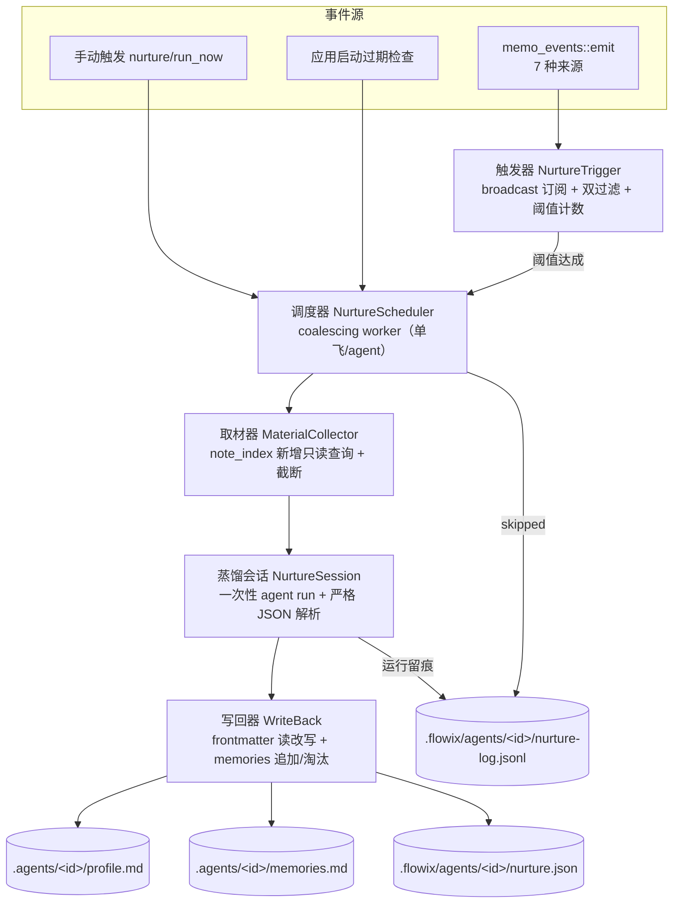

# F2 喂养管道设计（详细版）

> 状态：设计稿 v2.0（详细设计，待评审）｜ 2026-10-17
> 取代：AGENT-NURTURE-PIPELINE.md v1.0（概要设计）
> 上游：[AGENT-NETWORK-PLAN.md](./AGENT-NETWORK-PLAN.md) F2 域、决策 FD-3
> 前置：[AGENT-PROFILE-MODEL.md](./AGENT-PROFILE-MODEL.md)（写回目标契约）、[REDACTION-PIPELINE.md](./REDACTION-PIPELINE.md)（scope 的 Tag 粒度）

## 1. 设计概述

### 1.1 目的与范围

喂养管道让个人 Agent 的身份卡随笔记本内容生长：新笔记累积到阈值后，自动跑一次本地蒸馏，把专长标签、简介与长期记忆写回 F1 定义的数据面。全程不出设备，蒸馏消耗用户自己的 Agent 运行时。

本设计覆盖：触发器、合并调度器、素材取材器、蒸馏会话、写回器五个组件的详细算法、数据 schema、接口契约与集成测试要点。

不覆盖：F1 数据模型本身、F6 出设备脱敏（喂养产物留本地）、身份卡 UI、note_index 内部表结构的变更（取材只加只读查询）。

### 1.2 需求追溯与已决策项

| 编号 | 需求 | 来源 |
| --- | --- | --- |
| N1 | 授权 scope 外内容不得进入喂养输入 | AGENT-NETWORK-PLAN §8 |
| N2 | 新增同领域笔记达阈值后，专长标签无人工干预更新 | AGENT-NETWORK-PLAN §6 阶段一 |
| N3 | 喂养成本可感知、有护栏 | AGENT-NETWORK-PLAN §7 |
| N4 | 喂养写回不触发新一轮喂养 | 本设计 |
| N5 | 蒸馏失败不破坏现有 profile/memories | 本设计 |

§9 未决事项在 v2.0 中决策如下（详见各组件小节）：

- D-N1：`expertise` 语义 = **全量替换**（LLM 看到现状返回完整列表，写回器整体覆盖）
- D-N2：兜底检查 = **惰性**（无独立定时器；触发事件时顺路检查，应用启动时做一次过期检查）
- D-N3：`memories.md` = **append-only + 200 条上限**，蒸馏时由 LLM 标记可淘汰项，写回器删除被标记的旧条目
- D-N4：多 agent 共享素材缓存 = **暂不做**（个人场景 agent 数少，成本可接受；>3 agent 共享同 scope 时再引入）

### 1.3 术语

| 术语 | 定义 |
| --- | --- |
| 素材 | 一次喂养输入的笔记集合：水位之后新增/更新、且在授权 scope 内 |
| 水位 | 上次成功喂养的时间戳，增量取材边界 |
| 蒸馏 | 一次性 Agent 运行，输入素材与现有画像，输出结构化更新 |
| 周期 | 触发→调度→取材→蒸馏→写回→记录的完整闭环 |

## 2. 总体架构



三条结构性约束。第一，单 memo-event 只做计数，不直接蒸馏——阈值达成才入队调度器。第二，调度器单飞合并（复用 `document_derived.rs` 的 BTreeMap+单循环模式）。第三，写回走 NoteService 笔记锁，其 watcher 事件回到触发器时被 `.agents/` 路径过滤拦截，循环在结构上不可能。

## 3. 组件详细设计

### 3.1 触发器 NurtureTrigger

**事件订阅**：在 `memo_events::emit`（[memo_events.rs](../app/flowix-desktop/src/memo_events.rs)）内新增一路进程内 `tokio::sync::broadcast` 分发（容量 256，无订阅者时发送即丢弃）。前端 Tauri 事件 `memo-event` 不变，现有调用方零影响。触发器在桌面启动时创建一个 `tokio::task` 订阅该 channel。

**事件结构**：触发器接收的载荷需包含 `source / notebook_id / relative_path / updated_at`。`MemoEvent::Updated { memo, derived_changed, source }` 中 `memo` 已含 `notebook_id`（通过 location）、`relative_path`、`updated_at`。在 broadcast 时派生出一个轻量 `NurtureTriggerEvent` 投递，避免把完整 `Memo` 跨线程传递。

**过滤算法**（逐条事件，顺序执行，任一不通过即丢弃）：

```
fn on_event(e: NurtureTriggerEvent):
    if e.relative_path starts_with ".agents/" or ".flowix/":
        return  // 防循环 / 本地数据
    scopes = AgentAccessStore.enabled_entries(e.notebook_id)  // Notebook|Folder|Tag
    if not any scope.contains(e.relative_path, e.tags):
        return  // N1: 越界
    if e.source not in {UserNew,UserImport,NotebookTemplate,UserEdit,ExternalTool,CloudSync}:
        return  // 理论上全部命中，留作防御
    counters[e.notebook_id][agent_id_for(e)] += 1
    if counters >= threshold:
        counters[...] = 0
        scheduler.enqueue(e.notebook_id, agent_id, manual=false)
```

`agent_id_for(e)`：该事件所属笔记本下、scope 覆盖该笔记的所有 agent（一个笔记可能落入多个 agent 的 scope，各自独立计数）。`scope.contains` 对 Notebook 永远 true；对 Folder 比较 `relative_path` 前缀；对 Tag 检查该笔记的 tags 数组是否含该 tag 或其子路径（`t == tag || t starts_with tag + "/"`）。

**重启计数恢复**：`counters` 为内存态，重启后清零。恢复策略：从 `nurture.json.watermark` 起，调 `note_index` 统计水位以来 scope 内素材条数 `n`，若 `n >= threshold` 则立即入队，否则 `counters = n`。这样重启不会丢失喂养机会也不会重复喂养。

### 3.2 调度器 NurtureScheduler

**结构**（对照 [document_derived.rs](../app/flowix-desktop/src/document_derived.rs#L9-L21)）：

```rust
struct Job { app: AppHandle, notebook_id: String, agent_id: String, manual: bool }
struct Pending { running: bool, jobs: BTreeMap<String, Job> }  // key = agent_id
static PENDING: OnceLock<Mutex<Pending>> = OnceLock::new();
```

`enqueue(notebook_id, agent_id, manual)`：拿锁，`jobs.entry(agent_id).or_insert_with(...)`，若已在运行则不重复 spawn；否则 `running = true` 后 spawn 单循环。

**执行循环**（每轮出队一个 job）：

```
loop:
    job = pending.jobs.pop_first()  // BTreeMap 按 agent_id 排序，公平轮转
    if none: pending.running = false; break
    state = nurture_state(job)  // 读 nurture.json
    if should_skip(job, state):
        log_skip(job, state); continue
    run_one(job, state).await  // 取材→蒸馏→写回，失败内部处理
```

`should_skip` 判断顺序（任一命中即 skip，留痕原因码）：

1. `state.paused == true`（连续失败暂停，仅手动触发可破）且 `!job.manual`
2. `now - state.last_run_at < interval_min` 且 `!job.manual`（默认 7 天）
3. `state.tokens_remaining_this_run <= 0`（per-run 预算耗尽）
4. `state.running == true`（防重入，理论上单飞已保证，留作防御）
5. 取材后素材为空（在 run_one 内判断，返回 `skipped::no_material`）

跳过与运行都写 nurture-log 一行，保证「为什么没喂养」可解释。

### 3.3 取材器 MaterialCollector

**新增 note_index 只读 API**（因现有 `search_notes_with_tag_filter` 要求非空 query，不适合列全量）：

```rust
// app/flowix-core/src/memo_file/note_index.rs（新增，只读查询）
pub fn list_memos_by_scope_updated_after(
    &self,
    notebook_id: &str,
    scopes: &[AccessScope],          // Notebook|Folder|Tag
    updated_after: i64,               // watermark
) -> io::Result<Vec<MemoMaterial>>;

struct MemoMaterial { relative_path: String, title: String, tags: Vec<String>, updated_at: i64 }
```

SQL 语义：`FROM notes n`，`WHERE n.updated_at > ?`，且满足任一 scope（Notebook 全选；Folder: `n.relative_path LIKE prefix || '%'`；Tag: `EXISTS (SELECT 1 FROM note_tags t WHERE t.relative_path=n.relative_path AND (t.tag=? OR substr(t.tag,1,length(?)+1)=?||'/'))`），并排除 `relative_path LIKE '.agents/%'` 与 `'.flowix/%'`，`ORDER BY n.updated_at DESC`。多 scope 之间 OR。

**取材管线**：

```
rows = note_index.list_memos_by_scope_updated_after(nb, scopes, watermark)
materials = []
total = 0
for row in rows:
    content = extract_body_content(read_note(row.relative_path))  // 剥 frontmatter
    if total + len(content) > MATERIAL_LIMIT_KB * 1024:
        truncated += 1; continue
    materials.push(Material{...content...})
    total += len(content)
return (materials, truncated)
```

`MATERIAL_LIMIT_KB` 默认 200。截断按 `updated_at DESC` 顺序优先保留最新（最新素材信息量更高）。`extract_body_content` 复用 [frontmatter.rs](../app/flowix-core/src/memo_file/frontmatter.rs#L134)。

### 3.4 蒸馏会话 NurtureSession

**运行时选型**：读取 profile.md 的 `flowix_agent_type`（必须 ∈ `agent_types.ts` 的 key，否则 `AGENT_TYPE_INVALID`）与 `flowix_agent_model`（空则用类型默认），通过桌面端既有的 agent run 编排（runtime_registry → lifecycle，与插件运行及用户发起的 agent turn 走同一路径）发起一次**非交互式一次性运行**。

**提示词三段**（沿用 [plugin.rs](../app/flowix-desktop/src/plugin.rs#L632) `prepare_prompt(id, user_prompt, context)` 的拼装纪律）：

```
[指令段]
你是画像维护助手。根据以下素材，更新 Agent「<display_name>」的专长标签、简介与长期记忆。
约束：
- 只依据素材，不臆造素材外事实
- 专长标签必须使用笔记本已有标签路径（见上下文的标签列表），格式 a/b/c
- 记忆要具体、可操作、不重复既有记忆
- 既有专长中仍然有效的必须保留
- 严格只输出 JSON，字段：expertise(数组)、bio(字符串)、memories(数组)、dropMemories(索引数组)
- 输出不得含 markdown 代码围栏，第一个 { 到最后一个 } 为结果

[上下文段]
## 当前画像
<profile frontmatter YAML>

## 既有记忆（memories.md 全文，逐条编号）
1. ...
2. ...

## 笔记本可用标签（仅这些路径合法）
<read_notebook_tag_paths()>

## 素材（共 n 条，total KB）
### 1. <relative_path>  tags: [...]
<content>
...

[用户段]
请为 Agent 给出更新。若需淘汰既有记忆，在 dropMemories 中填其编号。
```

**输出解析**（严格，解析失败整次 failed，不部分写入）：

1. 取 Agent 最终回复文本；
2. 截取首个 `{` 到最后一个 `}`（容忍前后的自然语言与围栏）；
3. `serde_json::from_str::<NurtureOutput>`；
4. 校验：`expertise` 每项过 `normalize_tag_path`；`memories` 每条 ≤ 500 字；`bio` ≤ 500 字符；`dropMemories` 索引在既有记忆编号范围内。

**预算与中断**：per-run token 预算（默认 200k）通过运行时的流式事件累计 input+output token，超预算即发送取消信号并留痕 `failed::budget_exceeded`，水位不推进。取消信号走运行时既有取消通道。

**失败语义**：运行失败/超时/取消/解析失败 → 不写回 → `consecutiveFailures += 1` → 若 ≥ 3 则 `paused = true`（手动 `nurture_resume` 清零）。水位不推进。

### 3.5 写回器 WriteBack

**输出到文件的映射**（D-N1 全量替换、D-N3 记忆淘汰）：

| 输出字段 | 写入目标 | 方式 |
| --- | --- | --- |
| `expertise` | profile.md frontmatter `flowix_expertise` | **全量替换**该字段值 |
| `bio`（非空） | profile.md frontmatter `flowix_bio` | 替换该字段；空则不动 |
| `memories` + `dropMemories` | memories.md | 删除被标记的旧条目 + 追加新条目 |
| — | profile.md frontmatter `flowix_updated_at` | 设为当前时间 |

**frontmatter 原位更新算法**（读改写，不动正文与人设）：

```
content = read_file(profile.md)
meta = extract_document_metadata(content)          // properties + body
new_props = meta.properties.clone()
new_props["flowix_expertise"] = output.expertise   // YAML array
if output.bio.is_some(): new_props["flowix_bio"] = output.bio
new_props["flowix_updated_at"] = now_ms
new_content = serialize_frontmatter(new_props) + "\n" + meta.body
NoteService.write_document(profile, new_content)  // 笔记锁 + 原子写 + DocumentMutationCoordinator.commit
```

`serialize_frontmatter` 复用 flowix-core 现有的 frontmatter 序列化工具（保持字段顺序与既有 `flowix_key` 等系统键）。写回经 watcher 广播的事件回到触发器时，因路径以 `.agents/` 开头被第一道闸拦截。

**memories.md 维护**（append-only + 200 上限 + LLM 标记淘汰）：

```
existing = parse_memories(memories.md)   // 编号数组
kept = [m for i,m in existing if i not in output.dropMemories]
kept.append_all(output.memories)
if kept.len > 200: kept = kept[len-200:]   // 保留最新 200
write_memories(kept)                        // 全量重写 memories.md（不是追加，但语义是淘汰旧+加新）
```

注意：虽名为 append-only，实现上 memories.md 是「淘汰旧 + 加新」后的全量重写；对用户而言不可改写单条历史，仅蒸馏可淘汰。新建 memories.md 时带 frontmatter `flowix_kind: agent-memories`。

**水位推进**（事务性约束）：先成功写 profile.md 与 memories.md，再原子更新 `nurture.json`（`watermark = max(material.updated_at)`、`consecutiveFailures = 0`、`last_run_at = now`、`tokens_total += used`）。若 nurture.json 写失败，日志告警但喂养视为成功（水位可下次补算）；若文件写失败，整次 failed，水位不动。

## 4. 状态机与事件

**喂养周期状态**（`nurture.json.state` 派生，非持久枚举）：

```
idle ──enqueue──> running ──success──> succeeded ──reset──> idle
                      │
                      ├─failed──> failed(×N<3) ──retry──> running
                      │             │
                      │             └─failed(×≥3)──> paused ──resume──> idle
                      └─skipped──> skipped ──> idle
```

**进度事件 `nurture-progress`**（Tauri 事件，前端消费）：

| kind | 载荷 | 触发时机 |
| --- | --- | --- |
| `started` | `{agentId, materialCount, materialBytes}` | 取材完成、蒸馏前 |
| `material_truncated` | `{droppedCount}` | 素材超上限被截断时 |
| `distilling` | `{tokensSoFar}` | 流式 token 累计（节流，每 1k token 一次） |
| `writing` | `{expertiseCount, memoryCount}` | 写回开始 |
| `succeeded` | `{watermark, tokensUsed}` | 水位推进后 |
| `failed` | `{reason, consecutiveFailures, paused}` | 解析/运行/写回失败 |
| `skipped` | `{reason}` | 无素材/间隔/预算/暂停 |

reason 码：`no_material` / `interval_not_elapsed` / `budget_exceeded` / `paused` / `parse_failed` / `run_failed` / `write_failed` / `agent_type_invalid`。

## 5. 接口契约

### 5.1 Rust 结构

```rust
pub struct NurtureTriggerEvent {
    pub source: MemoChangeSource, pub notebook_id: String,
    pub relative_path: String, pub updated_at: i64,
}

pub struct NurtureJob { pub notebook_id: String, pub agent_id: String, pub manual: bool }

pub struct NurtureMaterial {
    pub relative_path: String, pub title: String,
    pub tags: Vec<String>, pub content: String, pub updated_at: i64,
}

pub struct NurtureOutput {
    pub expertise: Vec<String>,
    pub bio: Option<String>,
    pub memories: Vec<String>,
    pub drop_memories: Vec<usize>,
}

pub struct NurtureState {
    pub version: u32,
    pub agent_id: String,
    pub watermark: i64,              // 上次成功喂养的最大 updated_at
    pub last_run_at: Option<i64>,
    pub consecutive_failures: u32,
    pub paused: bool,
    pub tokens_total: u64,
}
```

### 5.2 蒸馏输出 JSON 契约

```json
{
  "expertise": ["finance/财报", "industry/电商"],
  "bio": "聚焦消费电商领域的财报解读与归因",
  "memories": ["用户持续关注复购率与物流时效的关联"],
  "dropMemories": [2, 5]
}
```

### 5.3 IPC 命令

| 命令 | 参数 | 返回 | 错误码 |
| --- | --- | --- | --- |
| `nurture_status` | notebookId, agentId | `NurtureState` + 内存计数 | `PROFILE_NOT_FOUND` |
| `nurture_run_now` | notebookId, agentId | 运行回执（异步，进度走 `nurture-progress`） | `PROFILE_NOT_FOUND` `AGENT_TYPE_INVALID` `ALREADY_RUNNING` |
| `nurture_config_get` | — | 全局默认配置 | — |
| `nurture_config_set` | `{threshold?, intervalMinDays?, materialLimitKb?, tokenBudgetPerRun?}` | 更新结果 | `CONFIG_INVALID` |
| `nurture_resume` | notebookId, agentId | 清除 `paused` 与 `consecutiveFailures` | `PROFILE_NOT_FOUND` |

## 6. 数据设计

### 6.1 nurture.json（本地面，`<nb>/.flowix/agents/<id>/nurture.json`）

```json
{
  "version": 1,
  "agentId": "agt_a1b2c3d4e5",
  "watermark": 1760587200000,
  "lastRunAt": 1760600000000,
  "consecutiveFailures": 0,
  "paused": false,
  "tokensTotal": 452300
}
```

### 6.2 nurture-log.jsonl（本地面，同目录，上限 500 行 FIFO）

每行：
```json
{"ts":1760600000000,"kind":"succeeded","materialCount":12,"truncated":0,"expertiseCount":2,"memoryCount":1,"tokensUsed":18200}
```
kind: `started` / `succeeded` / `failed` / `skipped`；failed 带 `reason` 与 `consecutiveFailures`；skipped 带 `reason`。

### 6.3 ~/.flowix/nurture.json（设备级全局默认）

```json
{
  "version": 1,
  "threshold": 10,
  "intervalMinDays": 7,
  "materialLimitKb": 200,
  "tokenBudgetPerRun": 200000
}
```

## 7. 非功能设计

**成本护栏（N3）**：阈值 10 条 + 间隔 7 天（手动豁免）+ per-run 200k token + 连续失败 3 次暂停。用量口径复用 `flowix/session/usage`。

**防循环（N4）**：双闸——触发器丢弃 `.agents/`/`.flowix/` 路径；scope 定义排除这两个目录。云同步回流到对端设备的 `.agents/` 写回同样被拦。

**并发**：调度器单飞（同 agent 无并行蒸馏）；写回走笔记锁，与用户并发编辑 profile.md 时后写者拿最新内容重试一次，仍冲突则 failed，水位不推进。

**隐私**：全链路不出设备。蒸馏输出契约不含 `flowix_disclosure_scope`/`flowix_redaction_level`/`flowix_consultable`，写回器也不接受这些字段——隐私边界只由用户控制。

## 8. 影响与实施

| 触点 | 变更 | 性质 |
| --- | --- | --- |
| `memo_events.rs` | `emit` 内加 broadcast 分发 | 唯一侵入点 |
| `note_index.rs` | 新增 `list_memos_by_scope_updated_after` 只读查询 | 纯新增，不改表 |
| `nurture/`（新模块） | trigger/scheduler/collector/session/writeback | 全新增量 |
| `plugin.rs` | 不改（仅参考拼装纪律） | 无 |
| 前端 | 喂养状态区 + 手动触发 + 进度事件 | 增量 |
| F1（前置） | profile/memories 数据面 | 依赖 |

实施步骤：

1. **N1**：broadcast + 触发器双过滤 + 阈值计数 + 调度器骨架 + 留痕。验收：注入 `.agents/` 与 scope 外事件 100% 被拦；阈值触发入队且合并去重；重启后计数从水位恢复。
2. **N2**：note_index 新查询 + 取材器（含截断）+ 蒸馏会话 + 输出解析。验收：水位增量正确；截断留痕；非法 expertise 单项拒收不整批失败；超预算中断；连续失败 3 次暂停。
3. **N3**：写回器（frontmatter 读改写 + memories 淘汰追加 + 水位推进）+ IPC + 进度事件 + 前端。验收：新增 10 条同标签笔记 → expertise 自动更新；失败不推进水位；手动触发豁免间隔。

## 9. 集成测试用例（验收锚点）

| # | 输入 | 预期 |
| --- | --- | --- |
| T1 | scope 外笔记新增 15 条 | 不入队，计数不增长 |
| T2 | `.agents/profile.md` 被外部工具改写 | 触发事件被丢弃，不入队 |
| T3 | scope 内同标签笔记新增 10 条 | 入队 → 蒸馏 → expertise 含该标签 |
| T4 | 蒸馏输出 expertise 含非法 tag 路径 | 该单项丢弃，其余写入，留痕 dropped |
| T5 | 蒸馏输出 JSON 损坏 | failed，水位不推进，consecutiveFailures=1 |
| T6 | 距上次喂养 3 天触发 | skipped::interval_not_elapsed |
| T7 | `nurture_run_now` 在间隔内 | 正常运行（手动豁免） |
| T8 | token 累计超 200k | 中断，failed::budget_exceeded |
| T9 | 连续 3 次失败 | paused=true，自动触发被拦；`nurture_resume` 后恢复 |
| T10 | profile.md 被用户同时编辑 | 写回重试一次，冲突则 failed，水位不动 |
| T11 | memories.md 已有 198 条，蒸馏新增 5 条并标记淘汰 3 条 | 最终 200 条（淘汰 3 + 新增 5 = 200） |
| T12 | A 设备喂养写回经云同步到 B 设备 | B 触发器收到 `.agents/` CloudSync 事件并丢弃，不循环 |
