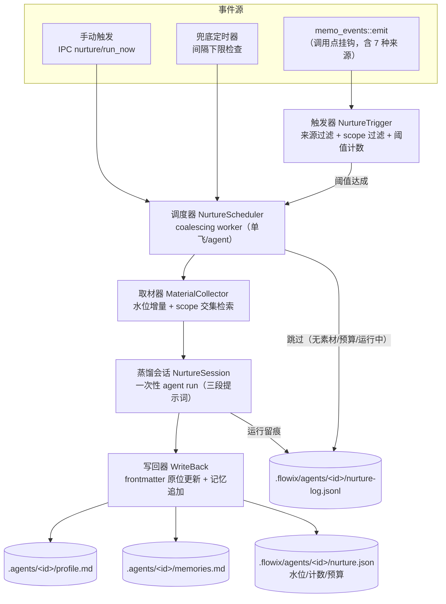
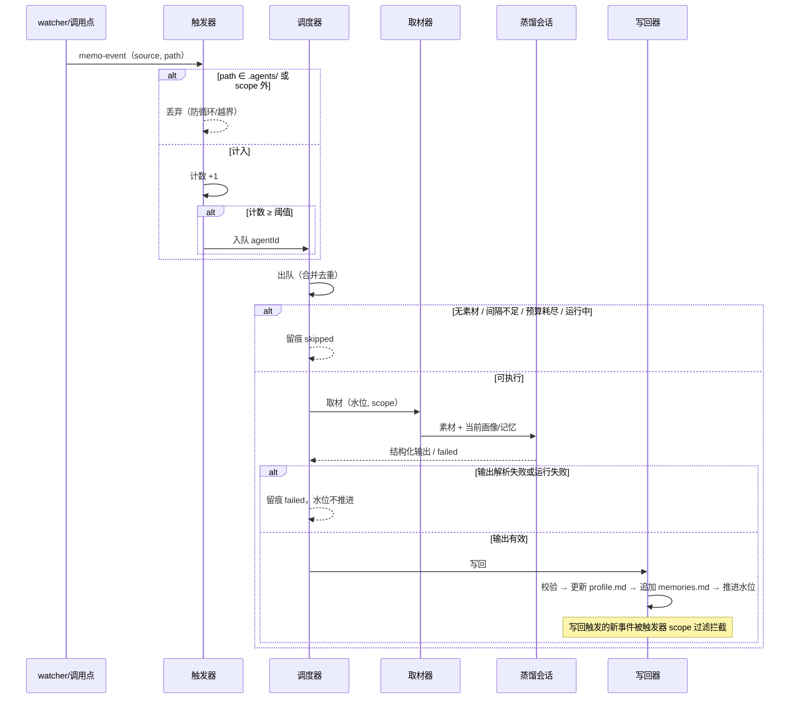

# F2 喂养管道设计

> 状态：设计稿 v1.0（待评审）｜ 2026-10-16
> 上游：[AGENT-NETWORK-PLAN.md](./AGENT-NETWORK-PLAN.md) F2 域、Saiye D2、决策 FD-3（无向量库，原文 + Markdown 蒸馏产物）
> 前置：[AGENT-PROFILE-MODEL.md](./AGENT-PROFILE-MODEL.md)（写回目标 profile.md / memories.md 的数据契约）

## 1. 设计概述

### 1.1 目的与范围

喂养管道让个人 Agent 的身份卡随笔记本内容生长：新笔记累积到阈值后，自动跑一次本地蒸馏，把专长标签、简介与长期记忆写回 F1 定义的数据面。全程不出设备，蒸馏消耗用户自己的 Agent 运行时。

本设计覆盖：触发器、合并调度器、素材取材器、蒸馏会话、写回器五个组件，及其数据面与接口契约。

不覆盖：F1 数据模型本身（见 AGENT-PROFILE-MODEL）、F6 出设备脱敏（喂养产物留在本地，不进入披露链路）、身份卡 UI。

### 1.2 需求追溯

| 编号 | 需求 | 来源 | 证据标签 |
| --- | --- | --- | --- |
| N1 | 授权 scope 外内容不得进入喂养输入 | AGENT-NETWORK-PLAN §8 度量表 | `[Data-backed]` |
| N2 | 新增同领域笔记达阈值后，专长标签无人工干预更新 | AGENT-NETWORK-PLAN §6 阶段一验收 | `[Data-backed]` |
| N3 | 喂养成本可感知、有护栏（阈值 + 间隔下限） | AGENT-NETWORK-PLAN §7 风险表 | `[Data-backed]` |
| N4 | 喂养写回不触发新一轮喂养（无循环） | 本设计推导 | `[Data-backed]` |
| N5 | 蒸馏失败不破坏现有 profile/memories | 本设计推导 | `[Data-backed]` |

前提假设：

- A1：F1 的 Profile 数据面与 `agent_profile_*` IPC 已落地（本设计依赖其写回目标）`[Hypothesis]`
- A2：`AgentAccessStore` 已扩展 `kind: Tag`（REDACTION-PIPELINE M1 范围）；未扩展时喂养按 Notebook/Folder 粒度工作，功能完整但取材粒度较粗 `[Hypothesis]`
- A3：用户至少配置了一个可用的 Agent 运行时（蒸馏无内置兜底模型，遵循 FD-1 全外接决策）`[Hypothesis]`

### 1.3 术语

| 术语 | 定义 |
| --- | --- |
| 素材（material） | 一次喂养的输入笔记集合：水位之后新增/更新、且在授权 scope 内 |
| 水位（watermark） | 上次成功喂养的时间戳，增量取材的边界 |
| 蒸馏（distill） | 一次一次性 Agent 运行，输入素材与现有画像，输出结构化更新 |
| 喂养周期 | 触发 → 调度 → 取材 → 蒸馏 → 写回 → 记录，一个完整闭环 |

## 2. 总体架构



三条结构性说明。第一，事件到调度是**条件路径**：单个 memo-event 只做计数，不直接发起蒸馏——阈值达成才把「待喂养的 agent」丢进调度器，这是成本护栏的第一层。第二，调度器是合并式的：同一 agent 的多次触发合并为一次运行（复用 `document_derived.rs` 的 coalescing worker 模式，BTreeMap 去重 + 单工作循环），运行中再触发只刷新 pending 标记。第三，写回路径与 F1 完全一致（NoteService 原子写 + 笔记锁），watcher 随后广播的 `ExternalTool` 事件回到触发器时会被 scope 过滤拦截（`.agents/` 不在素材 scope 内），循环在结构上不可能 `[Expert judgment]`。

### 2.1 组件职责

| 组件 | 职责（一句话） | 来源 |
| --- | --- | --- |
| NurtureTrigger | 过滤事件来源与路径，按 agent 累计素材计数，达阈值通知调度器 | 新建 |
| NurtureScheduler | 合并触发、串行执行、跳过判断（无素材/预算耗尽/已有运行） | 新建（模式复制 `document_derived.rs`） |
| MaterialCollector | 按水位与 scope 交集检索素材，输出脱 frontmatter 的正文集合 | 新建（检索复用 note_index 标签过滤） |
| NurtureSession | 组装三段提示词，发起一次性 Agent 运行，解析结构化输出 | 新建（运行复用 `agent_external` 生命周期；拼装复用 `plugin.rs` `prepare_prompt` 纪律） |
| WriteBack | 校验输出（tag-path 合法性），frontmatter 原位更新 + 记忆追加 + 水位推进 | 新建（写入复用 NoteService） |

依赖方向：Trigger → Scheduler → Collector/Session/WriteBack，单向无环；全部位于 `app/flowix-desktop`，不改动 flowix-core（素材检索走现有 note_index API，写回走现有 NoteService）。

## 3. 组件设计

### 3.1 触发器

**事件订阅机制**：`memo-event` 目前是发给前端的 Tauri 事件，云端同步在调用点直接挂钩。本设计在 `memo_events::emit` 内增加一个进程内 `tokio::sync::broadcast` 通道（前端 Tauri 事件不变，只是同帧多一路内部分发），触发器订阅该通道。这是对现有代码的唯一侵入性改动，且对现有调用方零影响（broadcast 发送失败即无订阅者，忽略）`[Expert judgment]`。

**来源过滤**（依据 `MemoChangeSource` 的 7 个变体，[memo_events.rs](../app/flowix-desktop/src/memo_events.rs)）：

| 来源 | 计入素材计数 | 理由 |
| --- | --- | --- |
| UserNew / UserImport / NotebookTemplate / UserEdit | 是 | 用户主动产生的知识 |
| ExternalTool | 是 | 外部编辑器与其他 AI 写入仍是用户语料 |
| CloudSync | 是 | 对端设备的笔记对本机而言是新素材；写回经同步后在另一设备触发时，同样被 scope 过滤（见防循环） |

**scope 过滤**：路径以 `.agents/` 开头的事件直接丢弃（写回自身产物，防循环的第一道闸）；不在任何授权 scope（`AgentAccessStore` 中 enabled 条目）内的事件丢弃。

**阈值计数**：per-agent 维护「自上次喂养以来的素材事件数」，达 `threshold`（默认 10）即通知调度器并清零。计数状态存内存，重启后从水位重算（见 §6）。

### 3.2 调度器

沿用 `document_derived.rs` 的结构：`Pending { running: bool, jobs: BTreeMap<agentId, Job> }` + `OnceLock<Mutex<...>>` + tauri async spawn 单循环。差异点：

- job 粒度是 agentId（非 memoId），同一 agent 重复入队只刷新条目；
- 执行前置检查（跳过即留痕，不运行）：素材为空（水位后无新笔记）、距上次运行小于间隔下限（默认 7 天，手动触发豁免）、per-run token 预算已耗尽、该 agent 已有运行中的蒸馏；
- 跳过与运行都写 nurture-log（见 §6），保证「为什么没喂养」可回答。

### 3.3 取材器

**输入**：agentId、水位、scope 条目集合。
**检索**：`note_index` 按标签过滤（scope 为 Tag 时）+ 按目录前缀（Notebook/Folder 时），条件 `updated_at > watermark`，排除 `.agents/**` 与 `.flowix/**`。
**输出**：素材条目集合 `{ relativePath, title, tags, content }`，content 为剥离 frontmatter 的正文（复用 `extract_body_content`）。

**体量护栏**：单次喂养素材总量上限默认 200 KB（按正文累计，超出按 `updated_at` 降序截断并在留痕中记录截断数）。上限的理由：蒸馏提示词必须装得进一次 Agent 运行的上下文，且成本与素材量线性相关——截断策略保证可预期 `[Expert judgment]`。

### 3.4 蒸馏会话

一次性 Agent 运行（非常驻会话）：每次冷启动注入当前 profile frontmatter + memories 全文 + 素材 + 指令，输出结构化更新。运行走 `agent_external` 的既有生命周期（流式、取消、看门狗、`classify_agent_error` 错误归一）。

提示词三段拼装（沿用 [plugin.rs](../app/flowix-desktop/src/plugin.rs) `prepare_prompt(id, user_prompt, context)` 的拼装纪律，但指令段不同）：

1. **指令段**：角色（画像维护者）、任务（从素材提炼专长/记忆）、输出契约（严格 JSON，见 §5.2）、约束（只依据素材、不臆造、保留既有有效记忆、expertise 使用笔记本已有标签路径）；
2. **上下文段**：当前 profile frontmatter（YAML 原文）+ memories.md 全文 + 素材集合（按条目分块，带 relativePath 与 tags）；
3. **用户段**：目标 agent 的显示名与本次素材摘要（n 条、共 x KB）。

运行时与模型：跟随该 agent 的 `flowix_agent_type` / `flowix_model`（F1 字段），用户未配置模型时用类型默认。蒸馏期间 UI 展示运行状态与预估用量（口径同 `flowix/session/usage`）。

**失败语义**：运行失败/超时/取消 → 不写回任何内容，留痕 `failed`，水位不推进（下轮重试同样的素材增量）；连续失败 3 次后暂停自动触发，等手动恢复（防 API 异常时空转烧钱）`[Expert judgment]`。

### 3.5 写回器

**输出校验**（逐项，不整批失败）：

- `expertise` 每项过 `normalize_tag_path`，非法项拒收并留痕（不阻塞其余项）；
- `memories` 每条 ≤ 500 字，超出截断；去重（与既有记忆做包含性检查，语义去重不做——无向量库，FD-3）；
- `bio` ≤ 500 字符（F1 约束）。

**写入**（两次原子写，均走 NoteService 笔记锁）：

- profile.md：frontmatter 原位更新 `flowix_expertise` / `flowix_bio` / `flowix_updated_at`，**正文与人设不动**；
- memories.md：追加式写入——文件若不存在则创建（带frontmatter `flowix_kind: agent-memories`），新记忆以 `## <日期>` 分节追加，既有内容永不改写（append-only 保证记忆可溯源）。

**水位推进**：成功写回后 `nurture.json` 的 watermark 更新为本次素材中最大 `updated_at`，并重置失败计数。

## 4. 关键流程



两条路径值得说明。跳过路径不是异常而是常态：阈值清零后到下次触发之间，调度器的每次出队都会因「无新素材」被拦，这正是成本护栏的体现。失败路径的关键约束是**水位不推进**——保证失败的素材增量在下一轮完整重试，不丢喂养机会。

## 5. 接口契约

### 5.1 Rust 结构（flowix-desktop 内部）

```rust
pub struct NurtureTriggerEvent { pub source: MemoChangeSource, pub notebook_id: String, pub relative_path: String, pub updated_at: i64 }

pub struct NurtureJob { pub notebook_id: String, pub agent_id: String, pub manual: bool }

pub struct NurtureMaterial { pub relative_path: String, pub title: String, pub tags: Vec<String>, pub content: String }

pub struct NurtureOutput {
    pub expertise: Vec<String>,      // 建议的专长标签（增量或全量，见 §9 未决）
    pub bio: Option<String>,
    pub memories: Vec<String>,       // 追加的长期记忆条目
    pub dropped: Vec<DroppedItem>,   // 校验拒收项（内部留痕用）
}
```

### 5.2 蒸馏输出契约（Agent 必须返回的 JSON）

```json
{
  "expertise": ["finance/财报", "industry/电商"],
  "bio": "聚焦消费电商领域的财报解读与归因",
  "memories": ["用户持续关注复购率与物流时效的关联", "偏好先结论后数据的回答结构"]
}
```

解析纪律沿用插件输出的清洗规则：截取首个 JSON 对象、容忍 markdown 代码围栏、解析失败即整次 failed（不部分写入）。

### 5.3 IPC 命令

| 命令 | 参数 | 返回 | 错误码 |
| --- | --- | --- | --- |
| `nurture_status` | notebookId, agentId | `{ state, lastRunAt, watermark, pendingCount, consecutiveFailures, tokensLastRun }` | `PROFILE_NOT_FOUND` |
| `nurture_run_now` | notebookId, agentId | 运行回执（异步，进度走事件） | `PROFILE_NOT_FOUND` `AGENT_TYPE_INVALID` `ALREADY_RUNNING` |
| `nurture_config_get/set` | notebookId? | 全局默认 + per-agent 覆盖（阈值/间隔/素材上限/预算） | `CONFIG_INVALID` |
| `nurture_resume` | notebookId, agentId | 清除连续失败暂停标记 | `PROFILE_NOT_FOUND` |

进度事件：`nurture-progress`（kind: started/material_truncated/distilling/writing/succeeded/failed/skipped + 原因码），前端据此展示卡片状态。

## 6. 数据设计

| 路径 | 内容 | 同步 | 生命周期 |
| --- | --- | --- | --- |
| `<nb>/.flowix/agents/<id>/nurture.json` | `watermark`、`pendingCount`、`consecutiveFailures`、`paused`、`tokensTotal`、`lastRunAt` | 否（本地面） | 与 state.json 同级，原子写 |
| `<nb>/.flowix/agents/<id>/nurture-log.jsonl` | 每次运行/跳过/失败一行：时间、kind、素材数、截断数、拒收项、token 用量、错误归一码 | 否 | 上限 500 行，FIFO |
| `~/.flowix/nurture.json` | 全局默认配置（阈值 10、间隔 7 天、素材 200 KB、per-run 预算） | 否（设备级） | 用户可改 |

设计理由：水位与计数是**设备运行状态**（哪台设备先看到素材就先喂养，写回经云同步分发），放本地面与 F1 的 state.json 同列；nurture-log 是喂养的可解释性载体（「为什么我的专长标签变了」），属审计数据，不进同步面（与 FD-6 留档不进笔记本同理）。

## 7. 非功能设计

**成本护栏**（N3）：三层——触发阈值（默认 10 条）、间隔下限（默认 7 天，手动豁免）、per-run token 预算（默认 200k，超出即中断留痕）。UI 用量展示口径复用 `flowix/session/usage`。

**防循环**（N4）：双闸——触发器丢弃 `.agents/` 路径事件；scope 定义本身排除 `.agents/` 与 `.flowix/`。云同步场景下，A 设备喂养写回 → 同步到 B 设备 → B 触发器收到 `.agents/` 路径的 CloudSync 事件 → 被第一道闸拦截。

**并发**：调度器单飞保证同一 agent 无并行蒸馏；写回走笔记锁，与用户同时编辑 profile.md 时按 NoteService 既有冲突路径处理（后写者拿到最新内容重试一次，仍冲突则本次 failed，水位不推进）。

**隐私**：喂养全链路不出设备——素材来自本地 note_index，蒸馏走用户本地 Agent 运行时，产物写回本地文件。与 F6 的关系：喂养产物中的 `flowix_disclosure_scope` 等隐私字段**只由用户修改**，蒸馏输出的白名单不包含这些字段（输出契约 §5.2 中无此字段，写回器也不接受）。

## 8. 影响与实施

| 触点 | 变更 | 性质 |
| --- | --- | --- |
| `app/flowix-desktop/src/memo_events.rs` | `emit` 内增加内部 broadcast 分发 | 唯一侵入点，现有调用方零影响 |
| `app/flowix-desktop/src/nurture/`（新模块） | trigger / scheduler / collector / session / writeback | 全新增量 |
| `app/flowix-desktop/src/plugin.rs` | 不改（拼装纪律被参考，代码不耦合） | 无 |
| 前端 | 身份卡喂养状态区 + 手动触发入口 + 进度事件消费 | 增量 |
| F1（前置） | profile/memories 数据面与 IPC | 依赖项 |

实施顺序（对应 AGENT-NETWORK-PLAN 阶段一 F2 部分）：

1. **N1**：broadcast 分发 + 触发器（来源/scope 过滤 + 阈值）+ 调度器骨架 + 留痕。验收：`.agents/` 与 scope 外事件 100% 被拦（注入式测试）；阈值触发入队且合并去重。
2. **N2**：取材器 + 蒸馏会话 + 输出解析校验。验收：素材水位增量正确；截断留痕；非法 expertise 拒收不整批失败；连续失败 3 次自动暂停。
3. **N3**：写回器 + IPC/进度事件 + 前端状态区。验收：N2 验收用例（新增 10 条同标签笔记 → 专长标签自动更新）；失败不推进水位；手动触发豁免间隔。

## 9. 未决事项

1. `expertise` 输出语义：增量合并（LLM 返回新增项，写回器合并）vs 全量替换（LLM 看到现状返回完整列表）——倾向全量替换（LLM 有完整上下文，合并逻辑简单），但需在提示词中强约束「保留仍然有效的既有标签」`[To be confirmed]`
2. 兜底定时器的驻留形态：应用运行期内的 tokio interval（桌面开着才检查）vs 依赖触发事件的惰性检查（无独立定时器）——倾向后者（更简单，桌面应用常开场景下差异小）`[To be confirmed]`
3. `memories.md` 的遗忘机制：append-only 无限增长 vs 按条数上限淘汰最旧——倾向上限 200 条 + 喂养时让 LLM 标记可淘汰项 `[To be confirmed]`
4. 多 agent 订阅同一 scope 时的素材重复蒸馏：现状按 agent 各自跑（成本 ×N）——是否引入素材级缓存（同水位素材多 agent 共享一次取材，蒸馏仍各自跑）`[To be confirmed]`
