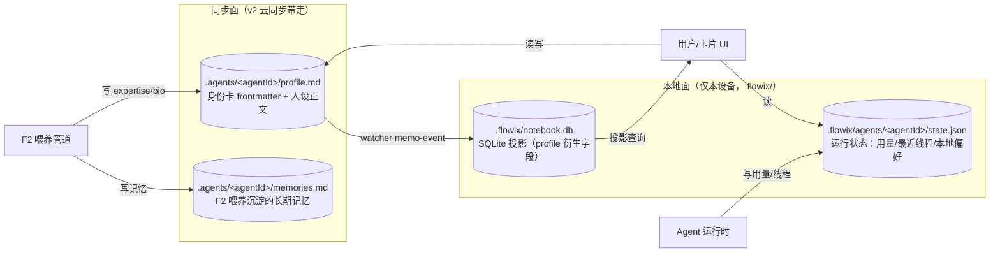

# F1 个人 Agent Profile 数据模型设计

> 状态：设计稿 v1.0（待评审）｜ 2026-10-16
> 上游：[AGENT-NETWORK-PLAN.md](./AGENT-NETWORK-PLAN.md) F1 域、Saiye D1、决策 FD-5
> 相关：[REDACTION-PIPELINE.md](./REDACTION-PIPELINE.md)（`disclosureScope` / `redactionLevel` 联动）、[docs/wiki/01](./wiki/01-项目概览.md)（数据面约定）

## 1. 设计概述

### 1.1 目的与范围

个人 Agent 的身份卡（Profile）在 Flowix 中承担三件事：作为 Agent 的唯一标识与自我介绍、作为 F2 喂养的写入目标（专长标签/画像）、作为 F5 网络互咨时对外发布的卡片与隐私边界声明。本设计定义 Profile 的数据模型、存储形态、字段契约与既有系统的集成点。

本设计覆盖：身份卡同步数据模型、本地运行状态数据模型、路径与命名约定、frontmatter schema、Rust 投影结构、IPC 命令。不覆盖：卡片 UI、F5 云端目录的服务端 schema（仅定义客户端可发布的字段子集）。

### 1.2 关键决策：双形态存储

FD-5 原定「Profile 即笔记 → 可同步」。核实代码后发现 `<notebook>/.flowix/` 是笔记本本地数据目录（`notebook.json`、`notebook.db`、`archives/`），不进入 v2 同步面；而同步面只包含用户 Markdown 笔记与附件。单一形态无法同时满足「可同步」与「不污染同步面」。

本设计沿用 Flowix 既有的「本地状态 / 同步笔记」拆分惯例，将 Profile 拆为两部分：

| 部分 | 路径 | 同步 | 承载内容 |
| --- | --- | --- | --- |
| 身份卡 | `<notebook>/.agents/<agentId>/profile.md` | 是（作为笔记） | 标识、名称、简介、专长标签、可咨询性、隐私边界声明、人设正文 |
| 运行状态 | `<notebook>/.flowix/agents/<agentId>/state.json` | 否 | 最后运行、用量计数、缓存线程、本地偏好 |

理由：身份卡是用户可阅读、可 Git、可跨设备一致的内容，属于笔记；运行状态（用量、最近线程）只对当前设备有意义，放入 `.flowix/` 与 `notebook.json` 同列。此拆分使 Profile 既能被 v2 同步带走，又不把设备临时状态推到云端 `[Expert judgment]`。

### 1.3 假设与术语

- 假设 A1：v2 同步会同步笔记根目录下除 `.flowix/`、`.plugin-output/` 外的 Markdown（含 `.agents/`）—— 由 `file_management.rs` 的跳过规则（仅跳过 `.flowix`/`.plugin-output`）推论 `[Hypothesis]`，需在同步引擎侧确认 `.agents/` 不被特殊过滤
- 假设 A2：`.agents/` 目录在 UI 中可折叠或隐藏展示（前端决策，不影响数据模型）`[Hypothesis]`

| 术语 | 定义 |
| --- | --- |
| agentId | Agent 的业务标识，格式 `agt_<10 位 base32>`，跨设备稳定 |
| 身份卡 | 同步面的 profile.md |
| 运行状态 | 本地的 state.json |
| expertise | 专长标签数组，复用笔记本 tag-path 语法 `a/b/c` |
| flowix_ 前缀 | Profile 在 frontmatter 中使用的系统键前缀，与现有 `flowix_key` 同族 |

## 2. 文件布局与命名

```
<notebook>/
├── .agents/                          # 同步面：所有 Agent 身份卡
│   └── <agentId>/                    # 例：agt_a1b2c3d4e5
│       ├── profile.md                # 身份卡（frontmatter + Markdown 正文）
│       └── memories.md               # 喂养沉淀的长期记忆（F2 写入）
├── .flowix/                          # 本地面：笔记本级 Flowix 数据
│   ├── notebook.json                 # NotebookManifest（既有）
│   ├── notebook.db                   # SQLite 投影（既有）
│   ├── archives/                     # 版本历史（既有）
│   └── agents/                       # 本地面：所有 Agent 运行状态
│       └── <agentId>/
│           └── state.json
```

命名约束：

- `agentId` 正则 `^agt_[0-9a-z]{10}$`，字符集与现有 `flowix_key`（`[0-9a-z]`）一致，避免大小写与特殊字符在跨平台路径上的歧义
- `agentId` 与 profile.md 所在文件夹名一一对应；移动/重命名 profile.md 不改变 agentId（agentId 存于 frontmatter，不依赖路径）
- 同一笔记本内 agentId 唯一；跨笔记本可重复（agentId 命名空间限定在笔记本内，F5 网络卡由 `notebookId + agentId` 联合定位）

### 2.1 数据拓扑



图中有两条值得注意的边界。第一，写路径：身份卡与记忆只由用户和 F2 喂养写入，运行状态只由运行时写入，两类数据各有单一写入方，避免跨域竞态。第二，索引投影（`notebook.db`）从 profile.md 的 watcher 事件派生，只读不写——这与 Flowix 「Markdown 是真源、SQLite 可重建」的整体纪律一致。

## 3. 身份卡数据模型（profile.md）

profile.md 是一篇标准 Markdown 笔记：YAML frontmatter 承载结构化字段，正文承载自然语言人设。

### 3.1 frontmatter schema

| 字段 | 类型 | 必填 | 约束 | 写入方 |
| --- | --- | --- | --- | --- |
| `flowix_profile_version` | int | 是 | 固定 `1`，schema 版本号 | 创建时 |
| `flowix_kind` | string | 是 | 固定 `agent-profile`，供索引层识别 | 创建时 |
| `flowix_agent_id` | string | 是 | `^agt_[0-9a-z]{10}$` | 创建时 |
| `flowix_display_name` | string | 是 | 1–64 字符 | 用户/喂养 |
| `flowix_bio` | string | 否 | ≤ 500 字符，单行摘要 | 用户/喂养 |
| `flowix_expertise` | string[] | 否 | 元素须通过 `normalize_tag_path`，引用笔记本内真实标签 | 喂养为主 |
| `flowix_consultable` | bool | 是 | 默认 `false`（默认不开放咨询） | 用户 |
| `flowix_agent_type` | string | 是 | 取值 ∈ `agent_types.ts` 的 key（codex/claude/hermes/opencode/pi/deepseek-harness/dsh） | 用户 |
| `flowix_model` | string | 否 | 覆盖默认模型，空则跟随 Agent 类型默认 | 用户 |
| `flowix_redaction_level` | string | 否 | `R1\|R2\|R3`，被咨询时允许的最高披露等级；空则拒答 | 用户 |
| `flowix_disclosure_scope` | string[] | 否 | 元素为 tag-path；被咨询时默认允许注入的内容范围 | 用户 |
| `flowix_created_at` | int | 是 | unix 毫秒 | 创建时 |
| `flowix_updated_at` | int | 是 | unix 毫秒，自动维护 | 系统 |

所有 `flowix_` 前缀字段在前端不展示为普通自定义属性——需将 `flowix_profile_*`、`flowix_kind`、`flowix_agent_id` 等加入 `is_system_frontmatter_key` 的识别集合（`app/flowix-core/src/memo_file/frontmatter.rs`），与现有 `flowix_key` 同等待遇。

### 3.2 正文（Markdown body）

正文是 Agent 的人设与自我介绍，自然语言书写。规则：

- 正文**不进入** F2 喂养的「专长标签自动生成」输入（防止自我描述循环强化），但可作为卡片展示与咨询时的自我介绍素材
- 正文**不进入** F6 出设备载荷（`disclosureScope` 默认不含自身 profile.md）；网络互咨时对端只看到 frontmatter 的公开字段（`display_name/bio/expertise`），正文按 `redaction_level` 决定是否摘要后披露

### 3.3 完整示例

```markdown
---
flowix_profile_version: 1
flowix_kind: agent-profile
flowix_agent_id: agt_a1b2c3d4e5
flowix_display_name: 财报解读助手
flowix_bio: 聚焦消费电商领域的财报解读与归因
flowix_expertise:
  - finance/财报
  - industry/电商
flowix_consultable: true
flowix_agent_type: deepseek-harness
flowix_model: ""
flowix_redaction_level: R2
flowix_disclosure_scope:
  - finance/财报
flowix_created_at: 1760587200000
flowix_updated_at: 1760587200000
tags:
  - agent
---

我是一名消费电商方向的财报分析助手。
擅长从复购率、SKU 结构、物流时效三个维度归因业绩波动。
回答偏好先给结论，再列数据，最后给归因假设。
```

## 4. 本地运行状态数据模型（state.json）

state.json 存于 `<notebook>/.flowix/agents/<agentId>/state.json`，仅本地，不进同步、不进 FTS 索引。

| 字段 | 类型 | 必填 | 说明 |
| --- | --- | --- | --- |
| `version` | int | 是 | 固定 `1` |
| `agentId` | string | 是 | 与身份卡一致 |
| `lastRunAt` | int\|null | 是 | 最后一次运行 unix 毫秒 |
| `lastConsultedAt` | int\|null | 是 | 最后一次被本机其他 Agent 咨询的时间 |
| `runs` | int | 是 | 累计运行次数 |
| `consultationsReceived` | int | 是 | 累计被咨询次数 |
| `tokensIn` | int | 是 | 累计输入 token（口径同 `flowix/session/usage`） |
| `tokensOut` | int | 是 | 累计输出 token |
| `recentThreadIds` | string[] | 是 | 最近 20 个 threadId，FIFO |
| `localPreferences` | object | 否 | 设备级偏好（如上下文窗口覆盖），不跨设备 |

写入方：桌面端 Agent 运行时调度器；读取方：卡片 UI、F2 喂养统计。写入采用原子写（复用 `config/user.rs` 的 `atomic_write_json`）。

示例：

```json
{
  "version": 1,
  "agentId": "agt_a1b2c3d4e5",
  "lastRunAt": 1760600000000,
  "lastConsultedAt": null,
  "runs": 42,
  "consultationsReceived": 0,
  "tokensIn": 120340,
  "tokensOut": 38120,
  "recentThreadIds": ["thr_01J...", "thr_01J..."],
  "localPreferences": { "contextWindow": 128000 }
}
```

## 5. 与现有系统的集成

### 5.1 笔记索引与投影（2026-10-17 实现时修订）

原设计假设「profile.md 作为普通笔记进入 note_index」。实现时经集成测试核实：`FileManagementPolicy::is_ignored` 对所有点开头目录（含 `.agents/`）整体排除（[file_management.rs](../app/flowix-core/src/memo_file/file_management.rs) `name.starts_with('.')`），profile 与既有 `.agents/agents/agent.md` 子代理配置同等待遇——**不进 note_index、不进 FTS、不出现在笔记列表**。该边界由测试 `profile_note_is_excluded_from_note_index` 锁定。

修订后的数据通路：

- 卡片 UI 数据源 = `agent_profile_list` IPC（直扫 `.agents/*/profile.md` 解析投影），不依赖 note_index
- F2 取材查询天然不会捞到 `.agents/`（索引排除 + 触发器路径过滤双保险）
- expertise 仍复用 `normalize_tag_path` 校验（写入侧约束，与索引无关）

### 5.2 与 Agent 运行时的关系

`flowix_agent_type` 取值严格限定为 `agent_types.ts` 的 key，启动 Agent 时按该 key 解析 capabilities（流式/非流式、是否支持 ACP）。`flowix_model` 为空时回退到 Agent 类型默认模型；非空时透传至运行时的 model 配置。

### 5.3 与 F2 喂养的接口

喂养管道的写回目标是 profile.md 的 `flowix_expertise`、`flowix_bio` 与同目录的 `memories.md`。写入走 `NoteService` 的标准原子写流程（加笔记锁），不绕过 watcher——watcher 会把 profile.md 的变更作为普通 memo-event 广播，卡片 UI 与索引层据此刷新。这条约束保证 Profile 的所有变更都经过与普通笔记相同的并发安全路径。

### 5.4 与 F6 隐私防线的联动

`flowix_consultable / flowix_redaction_level / flowix_disclosure_scope` 三个字段是 F6 脱敏管线的输入：

- `consultable == false` 时，咨询请求在 F5 入口直接拒绝，不进入脱敏管线
- `redaction_level` 是对端咨询时**允许的最高披露等级**（更敏感的 R1 需发起方显式升级并经确认门）
- `disclosure_scope` 是默认允许注入的标签范围，与发起方当次选择取交集（见 REDACTION-PIPELINE §3.1）

## 6. 接口契约

### 6.1 Rust 投影结构

```rust
// flowix-core: 身份卡的强类型投影（从 frontmatter 派生）
#[derive(Debug, Clone, Serialize, Deserialize)]
#[serde(rename_all = "camelCase")]
pub struct AgentProfile {
    pub profile_version: u32,
    pub agent_id: String,
    pub display_name: String,
    pub bio: Option<String>,
    pub expertise: Vec<String>,
    pub consultable: bool,
    pub agent_type: String,
    pub model: Option<String>,
    pub redaction_level: Option<RedactionLevel>,
    pub disclosure_scope: Vec<String>,
    pub created_at: i64,
    pub updated_at: i64,
}

#[derive(Debug, Clone, Serialize, Deserialize)]
#[serde(rename_all = "camelCase")]
pub struct AgentState {
    pub version: u32,
    pub agent_id: String,
    pub last_run_at: Option<i64>,
    pub last_consulted_at: Option<i64>,
    pub runs: u64,
    pub consultations_received: u64,
    pub tokens_in: u64,
    pub tokens_out: u64,
    pub recent_thread_ids: Vec<String>,
    #[serde(default)]
    pub local_preferences: serde_json::Value,
}
```

解析入口：`extract_document_metadata`（`frontmatter.rs`）已返回 `properties: Value`，新增 `AgentProfile::from_properties(properties) -> Result<Self, ProfileError>` 负责强类型转换与字段校验。

### 6.2 IPC 命令

| 命令 | 参数 | 返回 | 错误码 |
| --- | --- | --- | --- |
| `agent_profile_list` | notebookId | `AgentProfile[]`（仅投影字段，不含正文） | `NOTEBOOK_NOT_FOUND` |
| `agent_profile_get` | notebookId, agentId | `AgentProfile` + 正文预览 | `PROFILE_NOT_FOUND` |
| `agent_profile_create` | notebookId, fields | 创建结果 | `AGENT_ID_INVALID` `EXPERTISE_TAG_INVALID` `AGENT_TYPE_INVALID` |
| `agent_profile_update` | notebookId, agentId, patch | 更新结果 | `PROFILE_NOT_FOUND` `IMMUTABLE_FIELD`（agent_id/version 不可改） |
| `agent_profile_delete` | notebookId, agentId | — | （级联删除 state.json 与 memories.md） |
| `agent_state_get` | notebookId, agentId | `AgentState` | `STATE_NOT_FOUND` |

写入类命令全程走笔记锁（与 `NoteService` 一致），`agent_id` 与 `profile_version` 为不可变字段，patch 中出现即返回 `IMMUTABLE_FIELD`。

## 7. 约束与演进

**命名空间边界**：Profile 的所有结构化字段以 `flowix_` 前缀隔离，不占用用户自定义 frontmatter 命名空间。新增字段须先加进系统键识别集合，否则会被当作普通属性展示。

**与既有 agent 概念的区分**：`MemoIndexEntry.agents`（`AgentThreadItem`）是「笔记 ← 线程」的反向引用，属于笔记侧；`AgentProfile` 是「Agent 身份」，属于 Agent 侧。两者不共享存储、不互相推导，仅通过 `agent_type` 词汇表关联。

**schema 版本化**：`flowix_profile_version` 与 `state.version` 各自独立演进；读取时未知版本按当前最高已知版本兼容读取并打 warn（参照 `AgentAccessStore` 对未知 version 的处理模式）。

**不做事项**：不在 profile.md 中存放密钥、token、对话原文——这些分别走 DSH credential 体系与 thread.db，不进同步面。

## 8. 验收标准

| 项 | 标准 |
| --- | --- |
| agentId 格式 | 非法字符集/长度的创建请求 100% 被拒（`AGENT_ID_INVALID`） |
| 系统键隔离 | `flowix_*` 字段不进入前端「自定义属性」展示区 |
| expertise 合法性 | 含未通过 `normalize_tag_path` 的元素时写入被拒（`EXPERTISE_TAG_INVALID`） |
| 不可变字段 | patch 含 `agent_id`/`flowix_profile_version` 时返回 `IMMUTABLE_FIELD`，文件未变更 |
| 同步面正确性 | 仅 `profile.md`/`memories.md` 进入同步；`state.json` 不进入（v2 同步 dry-run 验证） |
| 并发安全 | 并发 update 与外部编辑器改写 profile.md 时，笔记锁保证无撕裂（复用 `locking.rs` 既有用例模式） |
| F6 联动 | `consultable=false` 的 Profile 在 F5 入口被拒，不触发脱敏管线 |

## 9. 未决事项

1. `.agents/` 目录在笔记列表 UI 中的呈现（折叠/隐藏/标记图标）—— 前端决策，不阻塞数据模型 `[To be confirmed]`
2. `flowix_redaction_level` 为空时的默认语义：拒答 vs 跟随全局默认——倾向拒答（显式优于隐式）`[To be confirmed]`
3. expertise 引用的标签在笔记本中被删除时的处理：自动移除 vs 保留孤立项——倾向自动移除并记日志 `[To be confirmed]`
4. F5 网络公开卡的字段白名单（哪些 frontmatter 字段可对外发布）—— 路线 B 阶段定 `[Hypothesis]`
