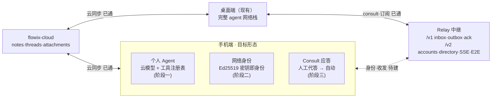

# 手机端个人 Agent 与 Agent 网络接入设计

> 状态：v0.2（M1-M4 已实现并验收，2026-10-30 模拟器全链路实测；E2E 盲转见开放项 M4b）｜ 2026-10-29 初稿

## 1 背景与范围

桌面端已完成 FD-11 Agent 网络（relay 中继、Ed25519 身份、订阅市场、consult 咨询、计量、E2E 盲转），移动端（flowix-mobile）目前仅有 OpenAI 兼容 SSE 直连对话（含 `web_search` 单工具循环）与 threads/notes/attachments 云同步。本设计回答两件事：

1. 手机端个人 agent 的实现形态（工具化路线）。
2. 手机端接入 Agent 网络的分层方案（身份、收发、consult 应答）。

不在本设计范围：桌面端功能变更（除 crate 抽取的等价迁移）、relay 服务端协议演进、端侧本地模型。

## 2 需求追溯

| 编号 | 需求 | 来源 | 证据 |
|---|---|---|---|
| R1 | 手机 AI 能检索并引用本机笔记内容回答 | 用户需求「手机端个人 agent」 | [Data-backed] |
| R2 | 手机可作为网络身份节点被寻址、被咨询 | 本设计推导（网络能力移动化） | [Expert judgment] |
| R3 | consult 到达手机后可完成应答回信 | 本设计推导 | [Expert judgment] |
| R4 | 网络产物（consult/订阅引用）跨端可见 | thread 同步已透传 tool 消息（v2.rs:153-169） | [Data-backed] |
| R5 | 复用桌面网络栈，不重复实现协议 | redaction/ 纯 Rust 无 GUI 依赖 | [Data-backed] |
| R6 | 桌面端零回归（FD-11 基线含 byte-equal） | AGENT-NETWORK-PLAN 验收标准 | [Data-backed] |
| R7 | 密钥与 API 凭据不上云 | mobile-agent-plan 方案 §8 先例（api_key 不上云） | [Data-backed] |
| R8 | 无长连接/无推送约束下可用 | F5 明确 v2 拉取+ack、不做云推送 | [Data-backed] |

设计决策（关闭的开放问题）：

- D-1：个人 agent = 云模型 + 本机工具注册表；否决移植桌面 DSH 子进程运行时（Android 子进程受限、双 harness 维护）与端侧本地模型（桌面已不使用 rllm，端侧成本与产品定位冲突）。
- D-2：首批本机工具只读（`note_search` / `note_read`）；写类工具（建笔记/追加）后置且必须走「AI 落草稿 → 用户确认」。
- D-3：桌面 `src/redaction/` 核心（account/transport/e2e/inbox/directory 数据与 HTTP 部分）抽为 workspace 共享 crate `flowix-redaction`；L1 脱敏管线与确认门执法（`mod.rs::effective_target_level`）暂留桌面。
- D-4：consult 记录 v1 以既有 tool 消息字段透传（零 schema 改动），v2 再评估实体化。
- D-5：consult 应答 v1 为人工代答；自动应答待脱敏执法移植后（阶段三后置项）。
- D-6：移动端密钥存 app 私有目录文件（与桌面 `account.json` 同构）；Android Keystore 升级列为开放项。
- D-7：后台不轮询；前台短轮询 + 可选 SSE 长连，遵循既有 relay 配额（deliver 30/h、poll 120/h）。

## 3 架构



结构性质：手机与桌面之间只经 flowix-cloud 数据面互通、只经 relay 网络面互通，不存在手机-桌面直连通道，两条链路职责正交；所有出站信封走 `deliver_confirmed_envelope` 单一出口（transport.rs:43），入站只经 `poll_agent_inbox` 单一入口（inbound.rs:215），执法点收敛。

## 4 组件设计

### 4.1 工具注册表（M1，改造 chat.rs）

职责：把 [chat.rs](../app/flowix-mobile/src/agent/chat.rs) 中 `web_search` 的硬编码分支（工具定义 :268、循环 :283、dispatch :337）泛化为可注册工具表。

输入/输出：LLM `tool_calls`（name + JSON 参数）→ 工具结果字符串（进 `role=tool` 消息）。

边界：不做工具级权限系统（移动端工具全部只读或草稿型）；不改变消息落库与同步路径。

```rust
// app/flowix-mobile/src/agent/tools.rs（新增）
pub(crate) struct ToolCtx<'a> { pub state: &'a MobileState }

pub(crate) struct ToolDef {
    pub name: &'static str,
    pub definition: serde_json::Value, // OpenAI function schema
    pub run: Box<dyn Fn(&ToolCtx, &serde_json::Value)
        -> Pin<Box<dyn Future<Output = Result<String, String>> + Send>> + Send + Sync>,
}

pub(crate) fn registry() -> Vec<ToolDef>; // web_search + note_search + note_read
```

- `note_search`：遍历缓存笔记本调 `memo_file.search_notes(notebook_id, &query, limit)`（core 能力，[note_index.rs:1070](../app/flowix-core/src/memo_file/note_index.rs)），复用移动端 `search` 命令既有封装（[commands.rs:639](../app/flowix-mobile/src/commands.rs)）；输出 `title | relative_path | snippet` 行。
- `note_read`：按 `notebook_id + relative_path` 读全文前 N 字；复用 `build_note_context_suffix` 的取数路径（chat.rs:64-89：`get_notebook_config_by_id` + `path_from_relative` + `fs::read_to_string`）。
- 失败语义：工具执行失败返回 `Err` 文本进 tool 消息，不中断回合（与 web_search 现行为一致，round_failed 语义保留 chat.rs:384）。

### 4.2 flowix-redaction crate 抽取（M2）

职责：把桌面网络栈中「无桌面依赖」的部分迁为共享库，双端链接同一实现。

迁移清单（代码等价移动，桌面 re-export 过渡）：

| 桌面现址 | 去向 | 备注 |
|---|---|---|
| redaction/account.rs（RelayAccount :17、register_or_login :143） | flowix-relay-client/account.rs | 密钥读写路径参数化（见下） |
| redaction/transport.rs（deliver_confirmed_envelope :43） | flowix-relay-client/transport.rs | 原样 |
| redaction/e2e.rs（seal :40 等 NaCl box） | flowix-relay-client/e2e.rs | 原样 |
| redaction/inbound.rs（poll_agent_inbox :215、ack） | flowix-relay-client/inbox.rs | 原样 |
| redaction/outbox.rs（take_confirmed_payload 等） | flowix-relay-client/outbox.rs | `RedactionPreviewReport` 纯数据类型随迁，桌面 mod.rs re-export |
| redaction/mod.rs 的 `RedactionPreviewReport`（:591-608） | flowix-relay-client（类型） | 搬类型不搬逻辑；桌面 `pub use` 回 |

留在桌面：`consult_bridge.rs`、`consult_registry.rs`、`subscriptions.rs`、`auto_grant.rs`、`directory.rs`（publish_preview 与桌面管线耦合，随 M3 发卡设计定案后再拆，见开放项）、`mod.rs` 中 L1 脱敏管线与 `effective_target_level` 执法。

命名说明：原设计名 `flowix-redaction` 已被既有 L1 规则引擎 crate 占用（outbox 的 `RuleHit` 即来自它），共享网络客户端 crate 定名 `flowix-relay-client`，依赖既有 flowix-redaction 与 flowix-relay（wire 类型单一来源）。

关键适配：`account_path()`（account.rs:97）当前写死 `~/.flowix/redaction/account.json`；抽取后改为注入 `&Path`（桌面传原路径保持字节等价，移动端传 app data dir）。

### 4.3 移动端网络接入（M3）

职责：身份注册、inbox 轮询、consult 注入。

- 注册：`register_or_login(username, relay_url)` 直用（account.rs:143，relay 侧 /v2/accounts + challenge）。
- 轮询：App 前台激活时启动短轮询 task（间隔 ≥30s，遵 poll 120/h 配额）；`poll_agent_inbox` 拿到 consult 信封后：
  1. 新建/续用 `th_net_` 前缀 thread，落 user 消息（content=对方问题，`origin="network"`）；
  2. emit `threads-changed`（既有事件，列表自动刷新）；
  3. ack。
- 出站：见 4.4。

### 4.4 Consult 人工代答（M4）

职责：在 `th_net_` thread 内完成「AI 起草 → 用户确认 → 出站」。

流程：用户在 consult thread 回复 → 走既有 `agent_chat_send`（工具注册表自动可用，AI 可查本机笔记起草）→ 用户点击「发送回信」→ 组装信封（`in_reply_to` 命中对端 receipt）→ E2E `seal`（若对端卡声明公钥）→ `deliver_confirmed_envelope` → 落 assistant 消息（`origin="network"`）。

边界：不自动出站——**确认动作必须由用户点击触发**（对齐桌面确认门思想；自动应答是阶段三后置项，需先移植脱敏执法）。

## 5 接口契约

### 5.1 移动端新增 IPC 命令

| 命令 | 参数 | 返回 | 错误码 |
|---|---|---|---|
| redaction_status | - | `{registered, username, relayUrl}` | - |
| redaction_register | `{username, relayUrl}` | `AccountPublicInfo` | `redaction_account_exists`、`redaction_relay_unreachable`、`redaction_register_rejected` |
| redaction_poll_once | - | `{received, acked}` | `redaction_not_registered`、`redaction_relay_unreachable` |
| redaction_reply | `{threadId, messageId}` | `{delivered}` | `redaction_no_pending_consult`、`redaction_deliver_failed` |
| redaction_forget | - | - | - |

错误码沿用仓库小写 snake_case 机器码风格（对齐 `AGENT_THREAD_NOT_SYNCED` 等既有码的大写惯例时，网络域统一 `redaction_` 前缀小写，与 relay HTTP 语义对齐）。

### 5.2 工具 schema 示例（note_search）

```json
{
  "type": "function",
  "function": {
    "name": "note_search",
    "description": "在用户本机缓存的全部笔记本中做全文搜索，返回标题/路径/摘要",
    "parameters": {
      "type": "object",
      "properties": {
        "query": { "type": "string", "description": "搜索关键词" }
      },
      "required": ["query"]
    }
  }
}
```

## 6 数据平面

| 路径 | 内容 | 同步性 | 生命周期 |
|---|---|---|---|
| `<app_data>/redaction/account.json` | Ed25519 私钥 + relay 注册信息 | 仅本机（R7） | 注册创建，forget 删除 |
| `<app_data>/threads.db`（既有） | consult thread 以 `th_net_` 前缀复用既有表 | 经 flowix-cloud 同步 | 随会话删除 |
| app/flowix-relay-client/*（新 crate） | 共享网络客户端协议实现 | 代码 | 随 M2 建立 |
| app/flowix-mobile/src/agent/tools.rs | 工具注册表 | 代码 | M1 |
| app/flowix-mobile/src/redaction.rs | 移动端适配（路径注入/轮询 task/事件） | 代码 | M3 |

consult 记录 v1 落 `V2ThreadMessage` 既有字段（`tool_name="consult"`、`origin="network"`），不新增 schema（D-4）。

## 7 非功能与集成影响

- 安全：私钥不出 app 私有目录；出站内容经用户确认；E2E 盲转服务端零参与（既有性质保持）。
- 电量：后台零轮询；前台轮询间隔下限 30s；SSE 仅前台长连（可选能力）。
- 并发：轮询 task 与 `agent_chat_send` 共用 threads.db 写路径，经既有 `with_conn` 互斥锁串行化。

| 触点 | 改动性质 |
|---|---|
| app/flowix-mobile/src/agent/chat.rs | 侵入（工具循环泛化），需回归既有 web_search 行为 |
| app/flowix-mobile/src/agent/tools.rs | 新增 |
| app/flowix-mobile/src/redaction.rs、commands | 新增/追加 |
| app/flowix-desktop/src/redaction/* | 迁出 + re-export（侵入，M2 回归闸门） |
| app/Cargo.toml（workspace） | 追加 flowix-redaction |
| 前端 SettingsScreen（网络身份卡）/ ChatScreen | 追加 / 小修 |

## 8 实施步骤

- **M1 工具底座**：chat.rs 工具注册表 + `note_search`/`note_read`。验收：真机新对话问「我笔记里关于 X 有什么记录」，回答出现笔记命中片段且带工具行；既有 web_search 场景与空 threadId 新对话回归通过。
- **M2 抽 crate**：flowix-redaction 迁移 + 桌面 re-export。验收：桌面 FD-11 既有网络测试全绿，信封字节与迁移前一致（byte-equal 基线）。
- **M3 身份与收件**：注册/轮询/consult 注入。验收：真机注册 → 桌面向手机短地址发 consult → 手机 30s 内收到并出现于会话列表。
- **M4 人工代答回信**：reply 命令 + E2E。验收：手机代答回信，桌面端验签通过且（E2E 场景）可解密展示。

## 9 测试锚点

| # | 输入 | 期望 |
|---|---|---|
| 1 | 新对话问本机笔记内容 | 调 note_search，回答引用 title/snippet |
| 2 | note_read 指定路径 | 返回前 N 字正文，路径错误返回错误文本不中断回合 |
| 3 | 空笔记本搜索 | 工具结果「无命中」，正常收尾 |
| 4 | 同轮混合 web_search + note_search | 两工具行均落库，回合成功 |
| 5 | 新对话（threadId 空串）+ 工具循环 | 正常新建线程（chat.rs:111-113 回归） |
| 6 | redaction_register 合法参数 | relay /v2/accounts 200，account.json 生成 |
| 7 | register 时 relay 不可达 | `redaction_relay_unreachable`，不落半写状态 |
| 8 | 桌面 consult 手机地址 | 手机前台 30s 内 inbox 命中，th_net_ thread 出现问题消息 |
| 9 | 人工代答出站 | /v1/outbox 201，桌面验签通过 |
| 10 | E2E：手机 → 桌面公钥 seal | 桌面 unseal 得明文，relay 侧仅密文 |
| 11 | 抽 crate 后桌面 FD-11 网络套件 | 全绿且信封字节不漂移 |
| 12 | consult 产物 origin=network 在手机端渲染 | 正文可见（核对 ChatScreen.tsx:530-539 过滤不误伤） |

## 10 开放项

- [To be confirmed] Android Keystore 替代文件密钥的时机与迁移（D-6）。
- [已关闭] ChatScreen 对 `origin=desktop` 纯工具消息的过滤：M3 实测 consult 注入以正文消息（origin=network user 消息）呈现，不受过滤影响。
- [Hypothesis] 移动端发卡走简化确认（人工确认内容，无 L1 管线）是否可接受——需评审，若不可接受则 directory 完整状态机提前迁移。
- [To be confirmed] 自动应答（F4 移动等价）是否立项：依赖脱敏执法移植成本评估。
- [Hypothesis] relay 配额：deliver 匿名档按 IP 3/h（实测被测试信封耗尽触发 429）；已修——移动端回信经 `deliver_confirmed_envelope_with_token` 带 deviceToken 走认证档 30/h。桌面旧路径仍匿名投递，是否同样补 token 待定。
- **M4b（E2E 盲转）**：回信 E2E 加密依赖收件方目录卡公钥预取（directory 未迁移，见上）；另 `poll_agent_inbox` 盲转解密内部调用旧版 `read_account()`（home 路径），移动端收密文会降级为「无法解密」占位——迁移 directory 时一并参数化。

## 11 实现与验收记录（v0.2）

- **M1**（工具底座）：[tools.rs](../app/flowix-mobile/src/agent/tools.rs) 注册表（web_search/note_search/note_read）+ chat.rs 循环泛化。模拟器实测 note_search 定位 → note_read 读原文 → 基于原文回答。
- **M2**（抽 crate）：`app/flowix-relay-client`（account/transport/e2e/inbound/outbox + RedactionPreviewReport 类型），桌面 re-export 零改动；workspace lib 测试全绿（新 crate 20 项）。桌面集成测试编译因运行中 dev 实例锁 sidecar 未跑，发布前补。
- **M3**（身份与收件）：[redaction.rs](../app/flowix-mobile/src/redaction.rs)；agent_id=`{username}/mob`；30s 前台轮询 + 手动拉取。模拟器对真 relay（8.160.162.251:8788）实测：注册 → 匿名 consult → 拉取注入「网络咨询」线程正文可见。
- **M4**（人工代答回信）：`redaction_reply`（threadId 参数，非 5.1 表中 messageId）；复用 outbox 确认管线 + Ed25519 签名 + 带 token 投递。自环实测：AI 起草 → 发送回信 HTTP 200 → 回执留档 → 【回信】再次入站，闭环。
- 差异汇总：crate 定名 flowix-relay-client（原名被 L1 引擎占用）；directory.rs 未迁移（依赖桌面管线）；transport 新增 `deliver_confirmed_envelope_with_token`（桌面旧签名行为不变）。
