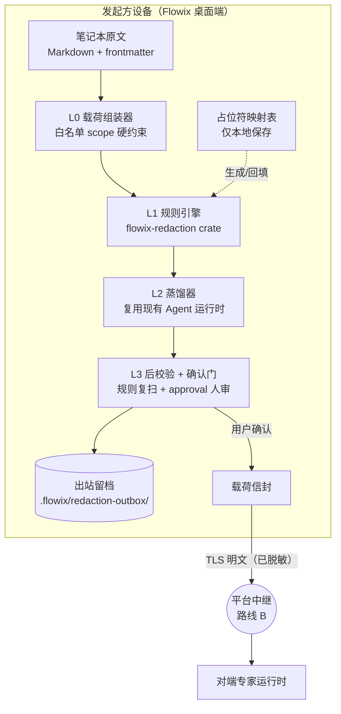
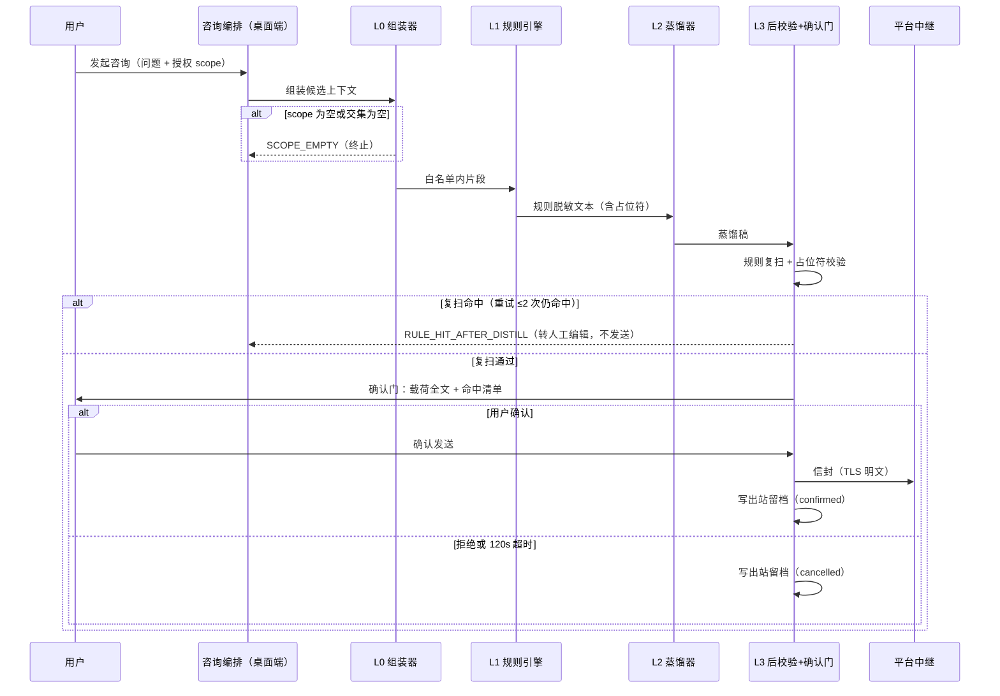

# 脱敏管线设计（网络互咨出设备内容防线）

> 状态：设计稿 v0.1（待评审）｜ 2026-10-16
> 上游依据：个人 Agent 方案评估（路线 B 网络互咨）+ 决策记录「不加密，仅做脱敏处理」
> 仓库基线：main（Flowix 1.5.6）

## 1. 设计概述

### 1.1 目的与范围

网络互咨（路线 B）要求把笔记本内容交给云端中继与对端专家 Agent，这与 Flowix「数据留在本地」的产品承诺直接冲突。本设计给出出设备前的内容防线：一条四层脱敏管线，把「原文出设备」改写为「用户确认过的最小披露包出设备」。

本设计覆盖：载荷组装、规则脱敏、LLM 蒸馏、后校验与人审确认门、出站留档、披露标记。

本设计不覆盖三项，均已有明确决策或归属：

- **端到端加密**：已决策不做（2026-10-16 会话决策）。理由：LLM 无法在密文上推理，可行的端到端边界仍会让对端专家明文可见；放弃加密换来实现面收缩与平台可读性（计费仲裁、滥用检测、内容合规均需平台读明文）`[Data-backed]`
- **平台中继与网络协议**：属路线 B 云端范畴，本设计只约定信封契约
- **喂养管道与身份卡**：另有设计，本管线只消费其产物（scope、技能等级声明）

### 1.2 上游需求追溯

| 编号 | 需求 | 来源 | 证据标签 |
| --- | --- | --- | --- |
| R1 | 未授权内容不得出现在任何出设备载荷中 | Saiye D2-c 隐私白名单 + 本会话 | `[Data-backed]` |
| R2 | 发送前用户必须看到并确认最终载荷全文 | 本会话确认门决策 | `[Data-backed]` |
| R3 | 出设备内容按可声明的等级脱敏（R1/R2/R3） | 本会话脱敏分级决策 | `[Data-backed]` |
| R4 | 每次发送可溯源（哪个版本、经哪次确认） | 本会话留档决策 | `[Data-backed]` |
| R5 | 被咨询方转咨第三方时披露受限 | 本会话披露标记决策 | `[Data-backed]` |

无正式 PRD，以下为支撑本设计成立的前提假设，路线 B 启动前需确认：

- A1 路线 B（网络互咨）立项，且平台中继愿意消费 `disclosure` 元数据 `[Hypothesis]`
- A2 身份卡（D1）与技能体系会声明各自所需的最低脱敏等级 `[Hypothesis]`
- A3 用户接受每轮咨询多一次本地 LLM 蒸馏调用（自己的 API key）`[Hypothesis]`

### 1.3 术语

| 术语 | 定义 |
| --- | --- |
| 披露（disclosure） | 任何离开本设备、平台或对端可见的内容 |
| 载荷（payload） | 一次咨询实际出设备的脱敏后文本与附件 |
| 信封（envelope） | 载荷 + 路由信息 + 披露标记 + 溯源信息的整体 |
| 白名单 scope | 允许进入管线的内容范围，粒度为笔记本 / 文件夹 / 标签路径 |
| 脱敏等级 R1/R2/R3 | 事实摘要 / 泛化摘要 / 领域抽象（见 §3.3） |
| 占位符 | 规则脱敏替换出的可回溯标记，形如 `⟦ORG-1⟧`，映射表只存本地 |
| 出站留档（outbox） | 每次发送（含取消）在本地的留档记录 |

## 2. 总体架构

管线整体位于发起方设备内，出设备点唯一且在确认门之后：



图中有三个设计要点。第一，L0 到 L3 全部串行且单向，任何一层失败都会终止发送，不存在跳过某层的旁路；出设备的唯一出口在 L3 确认门之后，这使「无确认不发送」成为结构性质而非流程约定。第二，占位符映射表与出站留档都只写本地，映射表内容（原文片段）永不出设备。第三，L2 不新增推理路径，直接复用桌面端已有的六种 Agent 运行时 spawn 机制（`app/flowix-desktop/src/agent_external/`），蒸馏就是一次普通的本地 Agent 会话。

### 2.1 组件职责与新增/复用

| 组件 | 职责（一句话） | 来源 |
| --- | --- | --- |
| L0 载荷组装器 | 只从白名单 scope 内取材组装候选上下文，越界内容在构造期丢弃 | 改造：基于 `AgentAccessStore`（`app/flowix-desktop/src/config/access.rs`）扩展 |
| L1 规则引擎 | 对文本跑确定性规则（正则/字典），替换为占位符 | **新建**：`flowix-redaction` crate（零 Tauri 依赖，纯函数） |
| L2 蒸馏器 | 用本地 Agent 会话把规则脱敏后的文本改写为目标等级 | 复用：Agent 运行时 + `plugin_prepare_prompt` 的提示词拼装模式（`app/flowix-desktop/src/plugin.rs`） |
| L3 后校验 + 确认门 | 规则复扫 L2 输出；向用户展示最终载荷全文并等待确认 | 复用：DSH approval 机制（`dsh-appserver/src/app-server/approvals/`） |
| 出站留档 | 记录每次发送/取消的完整信封与占位符映射 | 改造：参照 `.flowix/archives` 版本历史模式（`app/flowix-core/src/memo_file/versions.rs`） |
| 平台中继 | 密文无关的明文中转、计费、审计 | 路线 B 云端，不在本仓库 |

依赖方向无环：`flowix-redaction`（纯规则）← L0/L3（桌面端）← 信封序列化。`flowix-redaction` 不依赖 flowix-core，避免规则引擎与存储耦合 `[Expert judgment]`。

### 2.2 技术选型与理由

| 选型 | 理由 | 标签 |
| --- | --- | --- |
| 独立 crate `flowix-redaction` 而非塞进 flowix-core | 规则引擎是纯函数、无存储依赖；独立后可被 CLI/MCP 复用（如未来 `flowix redact` 子命令），且测试面最小 | `[Expert judgment]` |
| L1 用 Rust 正则 + 字典，不引入 NER 模型 | 确定性是这一层的价值：同输入必同输出，可单测、可审计；NER 属概率手段，放 L2 由 LLM 承担 | `[Expert judgment]` |
| L2 复用 Agent 运行时而非内置推理调用 | 用户已有 key 与偏好模型；运行时的流式/取消/看门狗/错误归一（`classify_agent_error`）全部白得 | `[Expert judgment]` |
| 确认门复用 DSH approval | 已有挂起/重放/超时（120s）/断连优雅期全套语义，前端已有审批卡片 UI 模式 | `[Expert judgment]` |
| 不加密 | 见 §1.1，用户决策 | `[Data-backed]` |

## 3. 分层详细设计

### 3.1 L0 载荷组装器

职责一句话：只让白名单内的内容获得进入管线的资格。

- **输入**：用户问题 + 授权 scope（D1 身份卡/技能声明的 `allowedScopes` 与用户当次选择取交集）
- **输出**：候选片段集合（原文，未脱敏），附来源路径清单
- **失败语义**：scope 为空或交集为空 → 直接报 `SCOPE_EMPTY`，不进入 L1；越界引用（如问题里粘贴的、指向 scope 外笔记的路径）在组装期丢弃并计入报告

实现基座是 `AgentAccessEntry`（现结构 `kind: Notebook | Folder`）。本设计新增 `kind: Tag`，`path` 字段存标签路径（复用前端 `lib/tag-path.ts` 与 flowix-core `normalize_tag_path` 的同一语法约束），取材执行点复用 CLI 已有的标签过滤检索（`flowix search -t`）`[Expert judgment]`。

边界：L0 不做任何内容改写，不理解语义；它只回答「这段内容有没有资格」。

### 3.2 L1 规则引擎

职责一句话：用确定性规则把文本中可模式化识别的敏感项替换为占位符。

规则目录（首版，内置在 crate 中，可用配置追加）：

| 类别 | 示例模式 | 替换形式 |
| --- | --- | --- |
| 手机号 | 中国大陆 11 位手机号正则 | `⟦PHONE-n⟧` |
| 邮箱 | 标准邮箱正则 | `⟦EMAIL-n⟧` |
| 证件/卡号 | 15/18 位身份证、13–19 位银行卡（含 Luhn 校验的可选收紧） | `⟦ID-n⟧` / `⟦CARD-n⟧` |
| 文件路径 | `/Users/<name>/…`、`C:\Users\<name>\…`、`~/…` | `⟦PATH-n⟧` |
| URL 凭据 | query 中的 token/key/sign 参数值 | `⟦URLSECRET-n⟧` |
| 绝对时间 | 具体日期时间 → 相对表述（"上周三"） | 原位改写 |
| frontmatter | 文档头 YAML 块整体剥离（复用 `app/flowix-core/src/memo_file/frontmatter.rs` 的解析边界） | 删除 |
| 自定义词表 | `~/.flowix/redaction/words.txt`，一行一项，支持 `原文=>替换` | 指定替换或 `⟦WORD-n⟧` |

占位符带序号，映射表（占位符 → 原文）只写入本地留档。回复文本中出现占位符时**默认不回填**：回填等于诱导对端拼图还原原文，默认策略是保留占位符原样展示给用户 `[Expert judgment]`。

边界：L1 不尝试理解内容。它的上限是「规则覆盖的类别内零漏检」，类别外的隐含身份（写作风格、事件序列）交给 L2 与人审。

### 3.3 L2 蒸馏器

职责一句话：把规则脱敏后的文本改写为目标脱敏等级的版本。

等级定义（与身份卡/技能声明的最低等级联动）：

| 等级 | 内容形态 | 例 |
| --- | --- | --- |
| R1 事实摘要 | 结论与数字，无叙事 | 「近 90 天复购率 23%，主力 SKU 3 个」 |
| R2 泛化摘要 | 去实体化叙事 | 「某电商公司 Q3 复购下滑，疑似与物流时效相关」 |
| R3 领域抽象 | 只有问题模式 | 「复购率下滑时如何归因物流环节？」 |

- **输入**：L1 输出文本 + 目标等级 + 蒸馏契约（输出仍是 Markdown 纯文本）
- **输出**：蒸馏稿（结构上就是一次普通 Agent 会话的最终回复，复用 `PluginRunCoordinator` 式的运行状态机与取消能力）
- **失败语义**：LLM 调用失败按运行时错误归一处理，可重试；重试耗尽后**不降级直发 L1 文本**，而是报 `DISTILL_FAILED` 交用户决定（R3 等级可提供纯规则模板兜底：截断+首句提取）

蒸馏提示词由三段拼装（沿用 `plugin_prepare_prompt` 的拼装纪律）：等级定义与改写规则、L1 输出文本、输出契约。提示词中写明「保留所有占位符原样」——占位符若被 LLM 改写，L3 复扫会因映射表对不上而拦截 `[Expert judgment]`。

边界：L2 不负责判断「该不该发」，只负责形态转换；能不能发由 L0（资格）与 L3（人审）决定。

### 3.4 L3 后校验与确认门

职责一句话：用规则复扫蒸馏稿，再把最终载荷全文交给用户逐字确认。

- 后校验 = 对 L2 输出重跑 L1 全部规则 + 占位符完整性校验。命中任何规则（典型场景：LLM 把敏感词「改写回来了」）→ 回炉 L2 重写（上限 2 次）→ 仍命中则报 `RULE_HIT_AFTER_DISTILL`，转人工编辑
- 确认门复用 DSH approval 的 server request 语义：挂起等待、120 秒超时、断连优雅期、SSE 重连补发。展示内容为最终载荷全文 + 命中清单（哪些占位符、哪些规则）+ 目标等级 + 收件方卡片
- 超时与拒绝同义：状态记 `cancelled`，留档，不发送

## 4. 关键流程

发送主流程（含两条失败路径）：



回程方向只有一条纪律：专家回复进入本机后一律按数据处理（与 P3 参数防注入同一原则），回复中的占位符不回填、回复中任何「请提供原文」类请求不自动满足，需再次走确认门。

## 5. 接口契约

### 5.1 载荷信封（对外契约，版本化）

```json
{
  "envelope": "flowix.consult.v1",
  "from": { "agentId": "agt_local", "displayName": "…" },
  "to": { "agentId": "agt_expert" },
  "disclosure": {
    "redactionLevel": "R2",
    "maxHops": 2,
    "hopsRemaining": 2,
    "expiresAt": "2026-10-23T00:00:00Z",
    "allowedScopes": ["tag:finance/财报"]
  },
  "payload": { "kind": "consultation", "text": "…", "attachments": [] },
  "provenance": {
    "pipelineVersion": "1",
    "ruleSetHash": "sha256:…",
    "distillAgent": "deepseek-harness",
    "confirmedBy": "user",
    "confirmedAt": "2026-10-16T10:00:00Z",
    "receiptId": "rct_01J…"
  }
}
```

| 字段 | 类型 | 约束 |
| --- | --- | --- |
| `disclosure.redactionLevel` | `R1\|R2\|R3` | 必填，与身份卡/技能最低等级校验通过后写入 |
| `disclosure.maxHops` / `hopsRemaining` | int ≥ 0 | 对端转咨时 `hopsRemaining - 1`，为 0 时对端不得携带本载荷内容再转咨（对端执行属路线 B 协议契约，本端只负责签发） |
| `disclosure.expiresAt` | RFC3339 | 默认 7 天 `[Expert judgment]` |
| `payload.text` | string | ≤ 64 KiB（超限报 `PAYLOAD_TOO_LARGE`）`[Expert judgment]` |
| `provenance.ruleSetHash` | sha256 | 规则目录内容哈希，留档比对用 |
| `provenance.receiptId` | string | 与出站留档一一对应 |

### 5.2 Rust API（flowix-redaction + 桌面端编排）

```rust
// flowix-redaction crate —— 纯函数层
pub struct RuleSet { /* 内置规则 + 用户词表编译产物 */ }
pub struct RuleHit { pub rule_id: String, pub span: (usize, usize), pub placeholder: String }

impl RuleSet {
    pub fn compile(config: &RedactionConfig) -> Result<Self, RedactionError>;
    pub fn apply(&self, text: &str) -> ApplyOutcome; // { redacted_text, hits }
}

// 桌面端编排（伪接口，职责边界见 §3）
pub struct RedactionRequest { pub question: String, pub scope: DisclosureScope, pub target_level: RedactionLevel }
pub struct RedactionReport { pub envelope: ConsultEnvelope, pub replacements: Vec<(String, String)>, pub hits: Vec<RuleHit> }

pub async fn run_redaction(req: RedactionRequest, ctx: &PipelineCtx) -> Result<RedactionReport, RedactionError>;
```

### 5.3 IPC 命令（桌面端新增）

| 命令 | 参数 | 返回 | 错误码 |
| --- | --- | --- | --- |
| `redaction_preview` | question, scope, targetLevel | RedactionReport（未确认态） | `SCOPE_EMPTY` `DISTILL_FAILED` `RULE_HIT_AFTER_DISTILL` `PAYLOAD_TOO_LARGE` |
| `redaction_confirm` | receiptId | 发送结果 | `CONFIRM_TIMEOUT` `UNCONFIRMED_SEND_BLOCKED`（receiptId 不存在/未过确认门时，发送路径兜底拦截） |

错误码沿用 CLI 的稳定机器码风格（小写下划线），前端经 `error-message.ts` 归一展示。

## 6. 数据设计

新增/改造的本地数据面（全部在设备内）：

| 路径 | 内容 | 生命周期 |
| --- | --- | --- |
| `~/.flowix/redaction/config.json` | 默认等级、每技能等级覆盖、载荷上限、确认超时 | 用户可改，schema 版本化 |
| `~/.flowix/redaction/words.txt` | 自定义敏感词表 | 用户可改 |
| `<notebook>/.flowix/redaction-outbox/rct_<id>.json` | 出站留档：完整信封 + 占位符映射 + 状态机（`draft → confirmed/cancelled/failed`） | 上限 200 条，FIFO 清理 `[Expert judgment]` |
| `~/.flowix/agent-access.json` | `AgentAccessEntry` 新增 `kind: "tag"`，`path` 存标签路径 | 沿用现有跨窗口同步事件 |

实体关系：一次咨询（Consult）产生一份 RedactionReport 与一条 outbox 留档（receiptId 关联）；留档引用 RuleSet（经 ruleSetHash）与 scope（AgentAccessEntry 集合）。留档不是笔记、不进 FTS 索引、不参与云同步——它属于设备级审计数据，进笔记本会破坏「出设备内容可预期」这条线 `[Expert judgment]`。

## 7. 非功能设计

### 7.1 威胁模型与残余风险（本设计的诚实边界）

| 可见方 | 本设计后可见内容 | 状态 |
| --- | --- | --- |
| 网络窃听者 | 无（TLS） | 已覆盖 |
| 平台中继/存储 | 脱敏载荷 + 路由元数据 | 接受（决策见 §1.1） |
| 对端专家及其 LLM 提供商 | 脱敏载荷明文 | 接受；身份卡标注「端内推理/外接云 API」供咨询方知情选择 `[Hypothesis]`（依赖 D1） |
| 隐含身份泄露（风格、事件序列） | 部分缓解（L2 泛化 + 人审） | 残余风险，无法根除 |
| 回程 prompt injection | 回复按数据处理，占位符不回填 | 已设计，需测试兜底 |

### 7.2 性能与成本

- L1 单载荷（≤64 KiB）处理目标 < 50 ms（纯正则 + 字典，无 IO）`[Expert judgment]`
- L2 一次本地 Agent 会话：时延与 token 成本由用户所选模型决定，UI 展示预估用量（复用 `flowix/session/usage` 的计量口径）
- L0 取材走既有 FTS5 标签过滤检索，无新增索引

### 7.3 可观测性

- 每条留档自带 `ruleSetHash` 与管线版本，规则升级后旧留档仍可解释
- 管线各层命中/丢弃计数进入运行日志（复用 `runtime_log`，遵循现有「不记文档内容与路径」的日志纪律，只记计数与 rule_id）

## 8. 影响与实施阶段

存量系统变更点（全部为增量，feature flag `redaction.enabled` 关闭时零行为变化）：

| 触点 | 变更 |
| --- | --- |
| `app/` Cargo workspace | 新成员 `flowix-redaction` |
| `app/flowix-desktop/src/config/access.rs` | `AgentAccessKind` 增加 `Tag` 变体 + 校验 |
| `app/flowix-desktop/src/plugin.rs` | 蒸馏提示词拼装复用其模式（不改插件系统本身） |
| DSH approval（`dsh-appserver`） | 新增 disclosure 审批类别或复用 permissions 类别——实施时定 `[To be confirmed]` |
| 前端 | 确认门卡片（复用审批卡片交互）、scope 选择器扩展标签档 |
| 咨询发送路径 | 唯一出口处加 `UNCONFIRMED_SEND_BLOCKED` 兜底断言 |

实施顺序（每步独立可测、可回滚）：

1. **M1 地基**：`flowix-redaction` crate（规则目录 + 词表 + 单测 + 对抗样本集）；access 的 Tag 粒度。验收标准：对抗样本集内规则类别命中率 100%；scope 外内容在 L0 输出不可达（fuzz 验证）
2. **M2 蒸馏**：L2 编排 + R 等级 + L3 复扫。验收标准：LLM 改写回敏感词的注入样本被复扫拦截率 100%；占位符被 LLM 破坏时映射校验失败并回炉
3. **M3 出门**：确认门 UI + outbox 留档 + 信封签发。验收标准：无确认时发送路径被兜底拦截（`UNCONFIRMED_SEND_BLOCKED`）；发送字节与留档 byte-equal；取消/超时留档状态正确

## 9. 测试策略与未决事项

测试分四层：crate 单测（规则/编译/占位符）、桌面端集成测（L0 scope 不可达性 fuzz、L3 复扫注入样本）、端到端（确认门全流程含超时与拒绝路径）、留档一致性断言（发送内容与留档逐字节一致）。对抗样本集作为独立 fixture 维护（中文 PII、双平台路径、URL 凭据、frontmatter 边界、占位符破坏样本），随规则目录版本化。

未决事项：

1. approval 新增 disclosure 类别还是复用 permissions 类别（影响 dsh-appserver 改动面）`[To be confirmed]`
2. 占位符回填默认关闭，是否提供用户显式开启的「查看回填」能力（仅本地预览、不回传）`[To be confirmed]`
3. 平台对 `disclosure.hopsRemaining` 的消费与执法契约（路线 B 云端设计时定）`[Hypothesis]`
4. 蒸馏默认走哪个 Agent 类型/模型（建议跟随用户当前默认 Agent，配置可覆盖）`[To be confirmed]`
