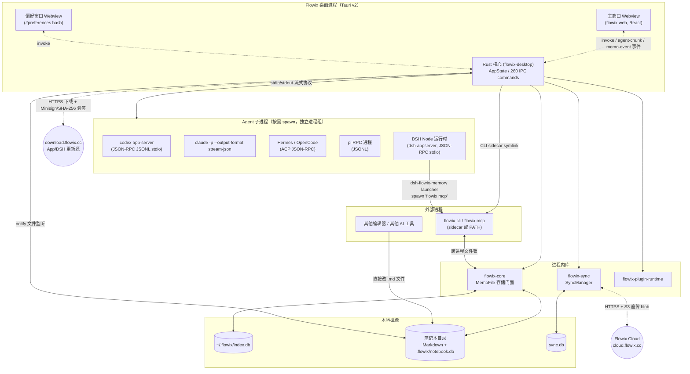
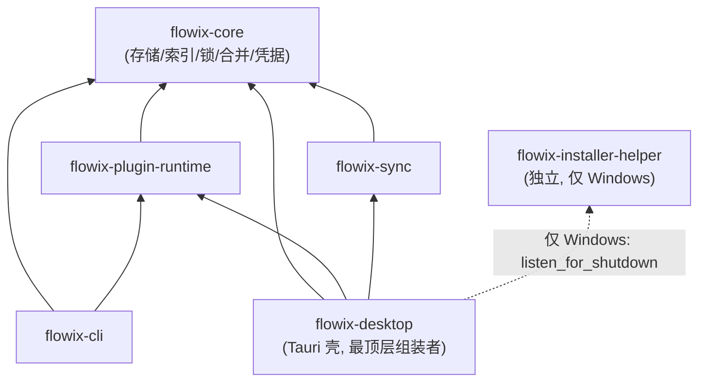
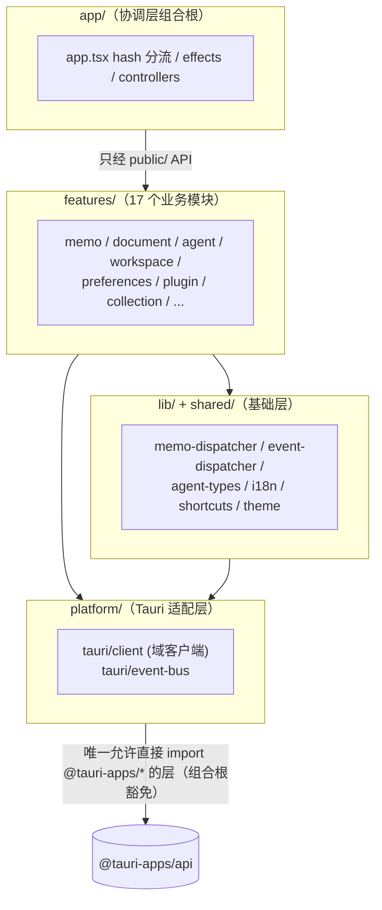

# 02 整体架构

## 1. 进程与运行时拓扑

Flowix 桌面应用运行时的全部进程/组件关系：



要点：

1. **单桌面进程，多 Webview**：主窗口与偏好窗口是同一 SPA 按 hash 路由分流的两个 Webview（各持独立 JS context）。
2. **Agent 全部为子进程**：Rust 侧为每种 CLI 建立独立进程组（Unix `process_group(0)`；Windows `taskkill /T /F` 兜底），看门狗 30 分钟空闲回收。
3. **DSH 独立分发**：DSH Node 运行时不随安装包走 Tauri 更新，而是按 manifest 单独下载、双验签、健康检查后原子发布（`<app data>/flowix/dsh/`）。
4. **CLI 与桌面共享存储**：`flowix-cli` sidecar 与桌面端通过 `~/.flowix/locks/` 跨进程锁协调对同一批 Markdown/SQLite 的并发读写。
5. **MCP 闭环**：DSH 内的 Agent 通过 `dsh-flowix-memory` 插件 spawn `flowix mcp`，即"Agent 用 Flowix 提供的工具读写 Flowix 笔记"。

## 2. Rust workspace 分层



- `flowix-core`、`flowix-plugin-runtime`、`flowix-sync` **零 Tauri 依赖**，可被 CLI、MCP 与未来的任何宿主独立复用。
- `flowix-desktop` 不对外暴露库 API，是纯粹的组装层（组合所有 crate + 子进程 + 窗口）。
- `flowix-installer-helper` 被 NSIS 安装器调用，与桌面端仅通过命名事件 `Local\Flowix.Maintenance.Exit.{pid}` 通信。

## 3. 前端分层契约

来源：`docs/FRONTEND-MODULE-BOUNDARIES.md` + `scripts/check-layer-boundaries.mjs`（CI 强制）：



状态所有权（单一真源）：workspace 拥有导航 target 与事务顺序；document 拥有编辑会话与脏保存；memo 拥有列表选择；agent 拥有会话投影与 run 生命周期；preferences 拥有用户设置；shell 只拥有面板几何。

## 4. 核心数据流

### 4.1 笔记写入（应用内编辑）

```
编辑器 debounce 保存
  → invoke write_document / save_memo (带 expectedContent 乐观锁)
  → DocumentMutationCoordinator.commit()          # CAS 内容修订（期望 hash 不匹配=冲突）
  → MemoFile.with_file_write()                    # 跨进程文件锁 + 原子写（临时文件+sync+rename）
  → commit_note_content_revision_if_current()     # SQLite revision 链
  → memo_events emit memo-event{updated, source: user_edit}
  → 前端 memoDispatcher（50ms dedup 中间件）→ 列表/标签/todo 局部刷新
  → watcher processor 记录 v2 本地变更 → 云同步 dirty 队列
```

### 4.2 外部编辑（其他编辑器 / 其他 AI 改文件）

```
notify 文件系统事件
  → watcher filter（whitelist / 自写抑制：写前后内容 hash 双标记 / debounce）
  → RenameTracker + RemoveCoalescer（450ms 墓碑合并）
  → 单 worker 线程串行处理（catch_unwind 隔离）
  → memo_file.refresh_note_path() 重建投影 → emit flowix:path-note-changed
  → memo-event{updated, source: external_tool} → record_v2_local_change()
```

### 4.3 Agent 对话

```
前端 chat_with_agent_stream
  → ExternalRuntimeRegistry.dispatch_chat()
      幂等准入（run_id + 消息指纹 → 重复请求订阅既有 watch channel）
      → tokio::spawn supervisor
  → 对应 runtime 子进程协议（Codex/DSH: JSON-RPC；Claude: stream-json；Hermes/OpenCode: ACP；Pi: RPC）
  → stdout 行解析（单行 512KiB 上限）→ AgentChunk（13 变体, snake_case wire）
  → StreamingEmitBuffer（200ms/64KB 合帧，保序）→ emit agent-chunk 事件
  → StreamEnd（AtomicBool CAS 只发一次）→ agent-run-terminal 事件 → admission 对账释放占用
```

### 4.4 云同步（v2 单轮）

```
sync_v2_account_once
  1 pending moves 补推 → 2 本地快照对账（磁盘 hash vs 已确认基线 → dirty）
  3 freeze：dirty → op_<uuidv7> + base_revision；note.put 先 reserve blob → PUT 直传 S3（SHA-256 校验）
  4 push：inflight 按 100/批 POST /v2/sync/push；409 REVISION_CONFLICT → 立即上抛（防回声覆盖）
  5 pull：GET /v2/sync/changes?cursor（跳过 self_sync_seqs 回声）；cursor 失效 → bootstrap 全量快照分页
  6 应用侧：v2_local_content_diverged() 判定本地未上传编辑，有则走 diffy 三方合并，失败存版本历史采云端
```

## 5. 关键设计决策（Why）

| 决策 | 原因 |
| --- | --- |
| Markdown 文件为唯一内容真源，SQLite 仅投影 | 用户可用任何工具打开/备份/版本化；索引损坏可随时重建（`reconcile_note_index`） |
| Note 身份 = 路径而非 ID | 与文件系统对齐，Git/同步/外部工具天然兼容；旧 Memo ID 只读兼容 |
| 三层锁体系（文件/笔记本/维护 + 旧版闸门） | 桌面端、CLI、MCP、外部编辑器四类写入方并发安全的基石（5s 超时 + 50ms 轮询） |
| 插件声明式（data-only manifest） | `~/.flowix/plugin/` 可安全扫描分发，插件不能执行任意代码；产物由 Host 校验后写入 |
| Agent 全部子进程化 + 独立进程组 | 崩溃隔离、可整组回收、支持用户自带 CLI（PATH 探测） |
| DSH 独立更新通道 | Node 运行时体积大、迭代快，与桌面 App 解耦；与 App 更新共用同一把 Minisign 公钥 |
| 事件驱动 + wire 镜像契约 | `AgentChunk`（Rust ↔ `types/agent.ts`）与 `MemoEvent`（`memo_events.rs` ↔ `types/memo.ts`）字段改动即破坏契约，双端必须同步 |
| 发布双通道 | GitHub Actions 只产草稿（安全）；生产更新器 manifest 由本地 `release.sh` 显式 `FLOWIX_PUBLISH=1` 发布（防误发） |
| manifest 按平台组拆分 | 各平台独立节奏发版，避免"无产出平台被误判有新版"的无限重装问题 |

## 6. 安全模型摘要

- **传输**：更新源强制 HTTPS；blob 直传 URL 强制 HTTPS。
- **签名**：App 更新与 DSH 更新共用 Minisign 公钥（内嵌 `tauri.conf.json`）；DSH 额外 SHA-256；无签名 manifest 直接拒绝。
- **凭据**：Access Token 只驻内存；Refresh Token 经 `RefreshTokenStore` trait 由桌面层持久化；`secret_kv` 表 `secure_delete=ON` + 0600。
- **子进程**：独立进程组可整组回收；跨进程诊断文本统一脱敏（API key/Bearer 正则）；DSH 插件子进程 `env_clear()` + 白名单环境变量。
- **路径**：逐段符号链接解析 + `..` 拒绝；插件 SKILL/integrity 路径 canonicalize 后必须仍在插件目录内；CSP `script-src 'self'`（主题引导脚本因此必须外链文件）。
- **审批**：DSH 审批以 JSON-RPC server request 回传客户端，Thread 租约绑定连接，防同机进程伪造。
