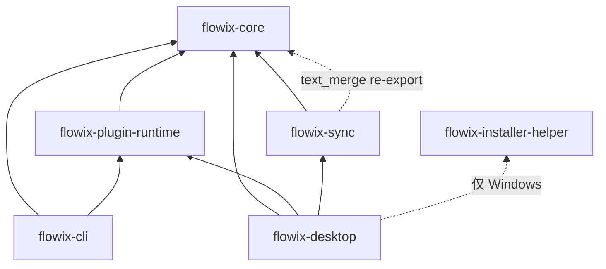
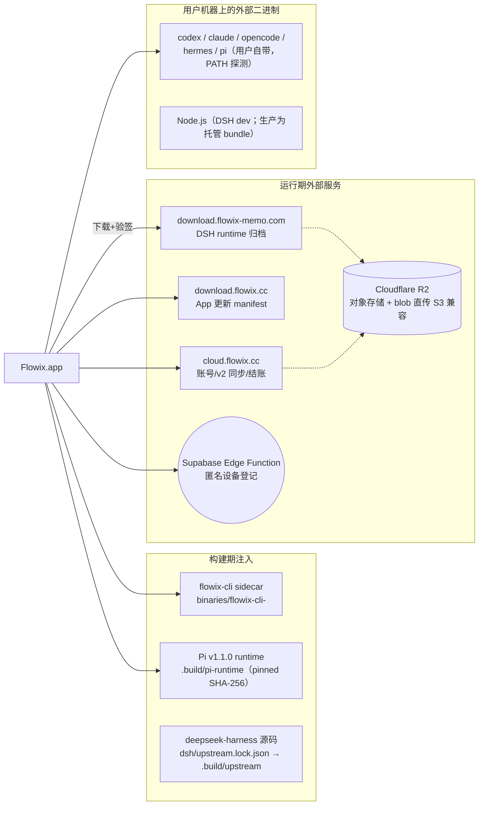

# 10 依赖关系全景

## 1. Rust crate 依赖图（app/ Cargo workspace，版本统一 1.5.6）



| crate | 内部依赖 | 关键外部依赖（workspace 统一锁版） |
| --- | --- | --- |
| flowix-core | — | serde/serde_json/serde_yaml、chrono、dirs、walkdir、regex、once_cell、thiserror、tracing、uuid(v4+v7)、nanoid、dunce、sha2、**rusqlite(bundled)**、tempfile、**fs2**（文件锁）、**diffy**（三方合并）；平台：linux/macos→libc（renameat2/renamex_np）、windows→windows-sys |
| flowix-cli | core、plugin-runtime | clap(std)、clap_complete、shell-words、windows-sys（Win32 console UTF-8） |
| flowix-plugin-runtime | core | serde_yaml、semver、sha2、uuid |
| flowix-sync | core | **reqwest(json)**、**tokio(sync+time)**、rusqlite、sha2、uuid(v7)、tracing、thiserror |
| flowix-desktop | core、plugin-runtime、sync（+helper 仅 Windows） | tauri 2 全家（process/updater/opener/deep-link/fs 等）、notify、tokio、minisign-verify、zip/flate2/tar、objc2（macOS Sign in with Apple）等 |
| flowix-installer-helper | —（独立） | dunce、windows crate 0.61（ToolHelp/RestartManager） |

> 设计约束：core / plugin-runtime / sync **零 Tauri 依赖**——CLI 与任何未来宿主可独立复用。release profile：`strip="symbols"` + thin LTO + codegen-units=1（缩小体积，发布流水线保留未 strip 归档用于符号化）。

## 2. npm 包结构

仓库是**单一 npm 根 + 两个子包**，无 npm workspace（包管理器钉 npm 10.8.2，禁 pnpm 锁文件）：

```
package.json（根）          # 前端依赖 + 全部构建 scripts（见 11 篇）
├── dsh-appserver/package.json    # 独立：vitest、TS（无运行时依赖，运行在 DSH 宿主内）
└── dsh-flowix-memory/package.json # 独立：零依赖 bundle
```

根 package.json 依赖分组：

| 组 | 代表包 | 用途 |
| --- | --- | --- |
| Tauri 桥 | `@tauri-apps/api`、plugin-opener/process/updater | IPC（仅 platform/ 层可 import，CI 强制） |
| UI 框架 | react/react-dom 19、`@base-ui/react`、radix、`@phosphor-icons/react`、lucide、sonner、cmdk、cva+clsx+tailwind-merge | 界面 |
| 编辑器 | `@tiptap/*` 3 全家、`@tiptap/markdown`、codemirror 6、shiki 4、katex、mermaid 11、markmap-lib/view、svg-pan-zoom | 富文本/代码/公式/图表/导图 |
| 数据/工具 | zustand 5、date-fns、papaparse、yaml、turndown、mammoth、docx-preview、pinyin-pro、github-slugger、tabulator-tables | 状态/解析/导出/表格 |
| devDeps | vite 7、`@vitejs/plugin-react`、typescript 5.8、vitest 4、tailwindcss 3.4、`@tauri-apps/cli` 2、`@yao-pkg/pkg`（Node 打包）、esbuild、shadcn、jsdom | 构建链 |

## 3. 二进制与外部服务依赖



- DSH 生产运行时**自带 Node 24**（自包含 bundle），不依赖用户 Node；dev 模式才探测本机 Node（nvm/fnm/volta/asdf/n）。
- 上游锁定：`dsh/upstream.lock.json` 固定 deepseek-harness commit（当前 `477b4f4`），`scripts/ensure-dsh-upstream.mjs` 浅克隆；生产模式禁止换源。
- Pi 集成细节见 `docs/PI-INTEGRATION.md`（每会话独立 Pi session 目录 + 可复用 RPC 进程）。

## 4. 前端内部层级依赖（CI 强制，scripts/check-layer-boundaries.mjs）

| 规则 | 内容 |
| --- | --- |
| A | `platform/lib/shared` 不得 import `@features/*`、`@app/*` |
| B | `features/shared/lib` 不得直接 import `@tauri-apps/*`（必须走 `@platform/tauri/*`；platform 与 app 组合根豁免；测试豁免） |
| C（棘轮） | 已迁移接缝必须走对方 feature 的 `public/` 入口，禁止深 import（清单只增不减） |
| D | Agent session slice 不得反向 import `agent-session-store`；该 store ≤650 行；`create<AgentSessionStore>` 全库恰好 1 次 |

## 5. 跨语言契约（改一处必须改另一处）

| 契约 | Rust 侧 | TS 侧 |
| --- | --- | --- |
| AgentChunk wire（13 变体，snake_case） | `app/flowix-desktop/src/agent_wire.rs` | `app/flowix-web/types/agent.ts` |
| MemoEvent / MemoChangeSource | `app/flowix-desktop/src/memo_events.rs` | `app/flowix-web/types/memo.ts` |
| memo 工具 schema | `app/flowix-cli/src/mcp.rs`（编译期内嵌） | `dsh-flowix-memory/memo-tool-schema.json` |
| RuntimeConfig 三态 patch | `flowix-desktop` threads.rs | `types/agent.ts::RuntimeConfigPatch` |
| 版本号三方一致 | `app/Cargo.toml` + `tauri.conf.json` | 根 `package.json`（tauri-dev/build 脚本启动时断言） |
