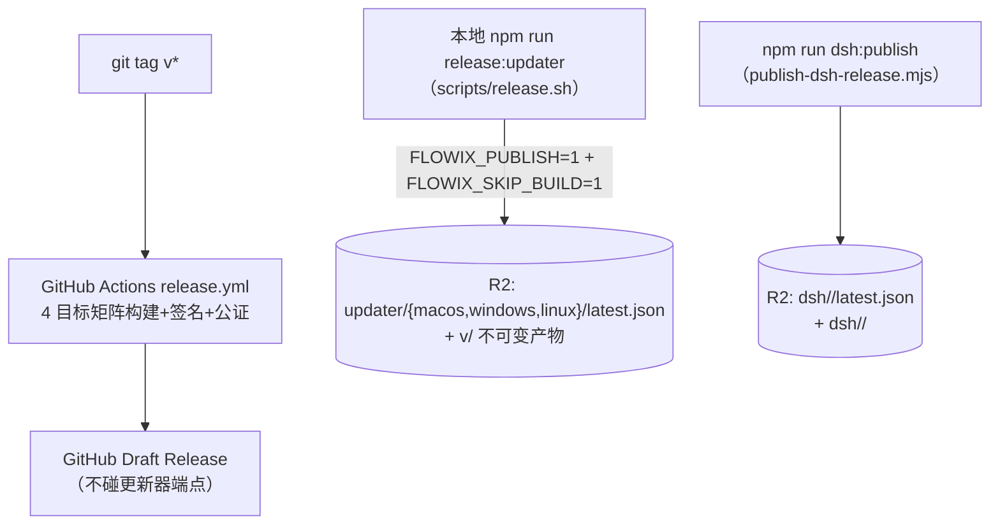

# 11 构建运行与发布

## 1. 本地开发

### 1.1 前置依赖

| 依赖 | 要求 |
| --- | --- |
| Node.js | 20+（DSH 生产打包另需 24） |
| npm | **钉 10.8.2**（`packageManager` 字段 + `scripts/check-package-manager.mjs` 校验，禁 pnpm 锁文件） |
| Rust | stable（README 标 1.75+），rustup |
| macOS 工具 | codesign/lipo/security/notarytool（发布期） |
| Linux 系统库 | libgtk-3-dev、libwebkit2gtk-4.1-dev、libappindicator3-dev、librsvg2-dev、patchelf、libssl-dev |

约定：Cargo 产物目录统一 `.build/cargo-target`（`app/.cargo/config.toml`）；版本三方一致（package.json ↔ app/Cargo.toml ↔ tauri.conf.json），dev/build 脚本启动即断言。

### 1.2 开发命令

```bash
npm install            # 安装依赖
npm run tauri dev      # ★ 完整桌面开发模式（dev 配置 com.flowix.app.dev，可与生产版并存）
npm run tauri:dev:pi   # 同上，但下载 pinned Pi v1.1.0（默认生产也内置 Pi）
npm run dev            # 仅前端 Vite（localhost:1420）
npm run test           # 前端 Vitest
npm run test:rust      # cargo test --workspace --lib
npm run check:layers   # 前端层级边界检查
```

`scripts/tauri-dev.mjs` 编排细节：Pi 发现（env `PI_CLI_PATH` → 复用已装应用资源 → `--with-pi` 下载）；DSH 本地构建默认跳过（`FLOWIX_BUILD_DSH=1` 显式开启，dev 可用 `FLOWIX_DSH_DEV_ROOT` 指向 `.build/dsh-runtime-dev/`）；macOS dev 轮询注册 `Flowix Dev` 深链防 Google 回调打开生产实例。

### 1.3 常用调试开关

| 变量 | 作用 |
| --- | --- |
| `FLOWIX_HOME` / `FLOWIX_DATA` | 覆盖 `~/.flowix` 数据目录（CLI，见 `app/flowix-cli/src/paths.rs`） |
| `FLOWIX_DSH_DEV_ROOT` | 指向本地 DSH runtime 目录 |
| `FLOWIX_PI_PROVIDER_CATALOG` | 指向 Pi provider 目录 |
| `FLOWIX_ALLOW_UNSIGNED=1` | 允许本地未签名生产包 |
| Agent 看门狗空闲超时 | 环境变量可覆盖（默认 30 分钟） |

## 2. npm scripts 全表（根 package.json）

| 组 | Script | 作用 |
| --- | --- | --- |
| 前端 | `dev` / `build` / `preview` | Vite；`build` = `tsc && vite build && check-web-bundle`（同时是 Tauri beforeBuildCommand） |
| 质量 | `test` / `test:rust` / `check:layers` / `check:package-manager` / `check:frontend-debt` / `check:web-bundle` | 见 12 篇 |
| 桌面 | `tauri:dev[:pi|:win]` / `tauri:build:prod[:pi]` | dev 覆盖层 / 生产打包编排 |
| CLI | `cli:build:dev` / `cli:build:prod[:macos]` | cargo 构建 flowix-cli 并 staged 到 `app/flowix-desktop/binaries/flowix-cli[-<target>]`（Tauri externalBin 约定） |
| DSH | `dsh:build:dev` / `dsh:build:prod[:macos\|:windows]` / `dsh:package:prod[:windows\|:local]` / `dsh:publish` / `test:dsh:packaging` | 三段式：构建 → 打包签名 → 发布 |
| Pi | `pi:bundle:prepare` | 准备 Pi runtime 包 |
| 安装器 | `build:windows-installer-helper` | 构建并签名 installer helper |
| 发布 | `release:updater` / `verify:flowix-package` | 更新器发布 / 单产物校验 |

## 3. 生产构建流水线

### 3.1 Tauri 打包（scripts/build-tauri-production.mjs）

```
强制 FLOWIX_BUNDLE_PI=1 → 解析更新器签名私钥（env / Keychain com.flowix.minisign.private-key）
→ 版本三方一致校验
→ 构建 CLI sidecar（macOS 默认双架构）
→ 准备 Pi bundle（按架构过滤）
→ 每个 target：prepare-tauri-production-config.mjs 生成 tauri.*.production.local.json
   （四层深合并：tauri.conf.json → 平台覆盖 → tauri.conf.production.json → 运行时注入：
     签名身份/证书 thumbprint/时间戳/entitlements/更新器端点/Pi 资源）
→ tauri build --config <生成配置> --target <target>
→ 产物断言：Windows NSIS *-setup.exe+.sig；macOS 每 target .dmg + .app.tar.gz + .sig；Linux .AppImage(.tar.gz)+.sig
```

### 3.2 DSH runtime 三段式

1. **上游固定**：`ensure-dsh-upstream.mjs` 按 `dsh/upstream.lock.json` 浅克隆 pinned commit；
2. **构建**（`build-dsh-prod.mjs`，强制 Node 24 + 架构一致，Apple Silicon 上 x64 走 Rosetta）：pnpm deploy 产出 runtime → 符号链接实体化 → koffi 等原生依赖修复与 Mach-O/ELF/PE 头校验 → 覆盖 `@deepseek-ai/dsh` + 本仓 dsh-appserver/dsh-flowix-memory → 组装 `profile/flowix` → 拷贝并 `lipo -thin` 单架构 node；
3. **打包签名**（`package-dsh-prod.mjs`）：codesign node 并验证 3 条 JIT entitlement 真实存在（非 jitless 启动冒烟）→ stdio 全生命周期冒烟（`smoke-dsh-package.mjs`）→ tar.gz → 用**包内目标架构 node** 从最终归档运行 `verify-dsh-archive.mjs` → SHA-256 + 同一把 Minisign 私钥签名 → 生成 `dsh-latest.json`。

## 4. 发布模型（双通道）



关键规则：

- **manifest 按平台组拆分**：每组 `latest.json` 只含本组实际产出的 platforms key（"没有产出的平台不结转"，防无限重装）；macOS/Windows 可独立节奏发版。
- **上传顺序**：先传不可变版本化产物 → 经公共 URL 回下载验证 → 才更新 `latest.json` → 回读比对；失败上传无法推进客户端版本指针。
- `FLOWIX_UPDATE_NOTIFY=false` 可发静默版；全量发布（三平台齐全）额外重建官网 Pages。
- Windows 静默安装结果经 `%LOCALAPPDATA%\FlowixData\app-update-result.txt` 回收校验（安装器 success 且当前版本==目标版本才算成功）。
- 签名贯穿：macOS Developer ID + notarization、Windows 证书 thumbprint + 时间戳、更新器 Minisign（**桌面与 DSH 共用同一把 key**，DSH 额外 SHA-256）。

## 5. CI（.github/workflows/）

| 工作流 | 触发 | 内容 |
| --- | --- | --- |
| `ci.yml` | push/PR → main | 三个并行 job：`dsh`（Node 24：打包测试 + dsh-appserver 全测）、`web`（Node 20 + npm 钉版：包管理器政策、tsc、build、bundle 预算、层级、债务、vitest）、`rust`（Linux：clippy --workspace --all-targets（暂不 -D warnings）、cargo test --workspace --lib） |
| `release.yml` | `v*` tag / 手动 | 4 目标矩阵：macOS 导入 p12 + notary key、Windows 导入 pfx、构建签名 installer helper、tauri-action 发布草稿、macOS 从最终 DMG 验证公证（`verify-macos-release.sh --notarized`） |

> 注意：`lefthook.yml` 当前仅是注释模板，**无激活的本地 Git hook**；所有质量门禁在 CI。CONTRIBUTING.md 中"PR bot 跑 cargo fmt --check / clippy -D warnings"的描述超前于现状，以 ci.yml 为准。
