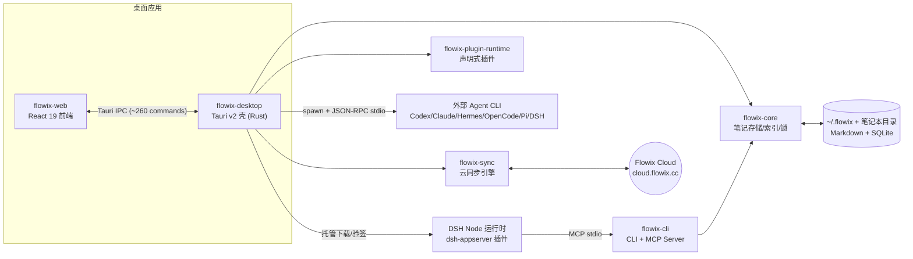

# Flowix Code Wiki

本目录是 Flowix 仓库的代码维基（Code Wiki），面向新加入的开发者与需要快速定位实现的维护者。全部内容基于源码分析生成，路径均相对仓库根目录。

> Flowix 是一个开源的 Markdown 笔记本 + AI Agent 桌面应用："Notes for you, Memory for your agents"。
> 用 Markdown 记笔记，把指定上下文交给 AI Agent（Codex / Claude Code / DSH / Pi 等）继续工作，结果再保存回同一篇笔记。

## 文档地图

| 文档 | 内容 |
| --- | --- |
| [01-项目概览](01-项目概览.md) | 项目定位、技术栈、仓库目录结构、核心概念表 |
| [02-整体架构](02-整体架构.md) | 进程/运行时拓扑、分层架构图、核心数据流、关键设计决策 |
| [03-核心库-flowix-core](03-核心库-flowix-core.md) | 笔记存储门面、路径投影索引、跨进程锁、服务层 API、数据目录约定 |
| [04-桌面壳-flowix-desktop](04-桌面壳-flowix-desktop.md) | Tauri 命令层、外部 Agent 运行时管理、DSH 分发、文件监听、更新与安全 |
| [05-前端-flowix-web](05-前端-flowix-web.md) | React 19 入口链、模块分层契约、状态管理、事件总线与类型契约 |
| [06-命令行-flowix-cli](06-命令行-flowix-cli.md) | 子命令清单、MCP Server、退出码与 JSON 输出契约 |
| [07-云同步-flowix-sync](07-云同步-flowix-sync.md) | 认证体系、v2 同步协议流水线、冲突处理、同步状态库 |
| [08-插件运行时与安装助手](08-插件运行时与安装助手.md) | 声明式插件契约（mindmap/webpage）、产物写入流程、Windows 安装预检 |
| [09-Agent运行时-DSH](09-Agent运行时-DSH.md) | dsh-appserver 分层架构、JSON-RPC 方法目录、事件投影、dsh-flowix-memory 插件 |
| [10-依赖关系全景](10-依赖关系全景.md) | Rust crate 依赖图、npm 包结构、外部服务与二进制依赖 |
| [11-构建运行与发布](11-构建运行与发布.md) | 本地开发步骤、全部 npm scripts、生产打包流水线、双通道发布模型 |
| [12-测试与质量保障](12-测试与质量保障.md) | 三语言测试布局、CI 门禁、静态检查脚本 |

## 一分钟速览



- **唯一内容真源**：磁盘上的 Markdown 文件；SQLite 只是可重建的投影索引。
- **Note 身份**：`(notebook_id, relative_path)` 路径键（Memo ID 仅为兼容保留）。
- **Agent 接入**：桌面壳以子进程方式宿主 6 种 Agent CLI；DSH 是 Flowix 托管分发的自包含 Node 运行时，通过 `dsh-flowix-memory` 插件 + `flowix-cli` MCP Server 读写笔记。
- **本地优先**：数据全部留在本地（`~/.flowix`），云同步（v2 协议）为可选叠加层。

## 快速开始（开发）

```bash
git clone https://github.com/text2future/flowix.git
cd flowix
npm install          # Node 20+，npm 钉 10.8.2
npm run tauri dev    # 完整桌面开发模式（Rust 1.75+ / Tauri v2）
npm run dev          # 仅前端 Vite dev server（localhost:1420）
npm run test         # 前端单测
npm run test:rust    # Rust workspace 测试
```

详见 [11-构建运行与发布](11-构建运行与发布.md)。

## 延伸阅读（仓库既有专题文档）

- [docs/NOTEBOOK-STORAGE.md](../NOTEBOOK-STORAGE.md) — 笔记本存储契约
- [docs/FRONTEND-MODULE-BOUNDARIES.md](../FRONTEND-MODULE-BOUNDARIES.md) — 前端模块边界维护契约
- [docs/PLUGIN-DEVELOPMENT.md](../PLUGIN-DEVELOPMENT.md) — 插件开发指南
- [docs/COLLECTION-INDEX.md](../COLLECTION-INDEX.md) / [docs/MULTIDIMENSIONAL-TABLE.md](../MULTIDIMENSIONAL-TABLE.md) — 集合与多维表格
- [docs/CLOUD_SYNC_ACCEPTANCE.md](../CLOUD_SYNC_ACCEPTANCE.md) — 云同步验收清单
- [docs/DSH-RELEASE.md](../DSH-RELEASE.md) / [docs/UPDATER-RELEASE.md](../UPDATER-RELEASE.md) / [docs/PI-INTEGRATION.md](../PI-INTEGRATION.md) — 发布与 Pi 集成
